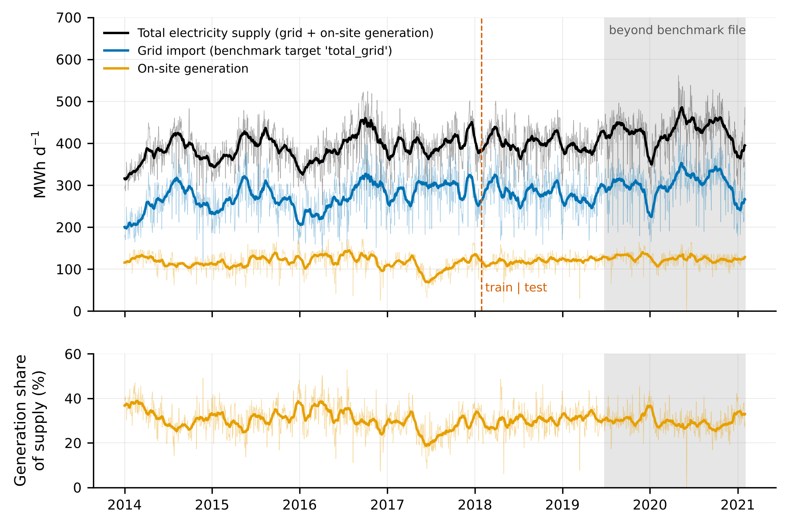
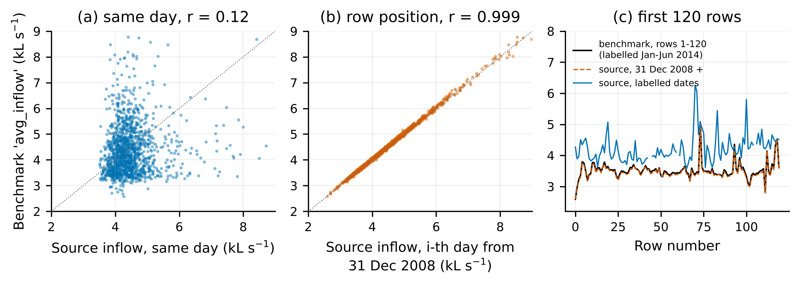
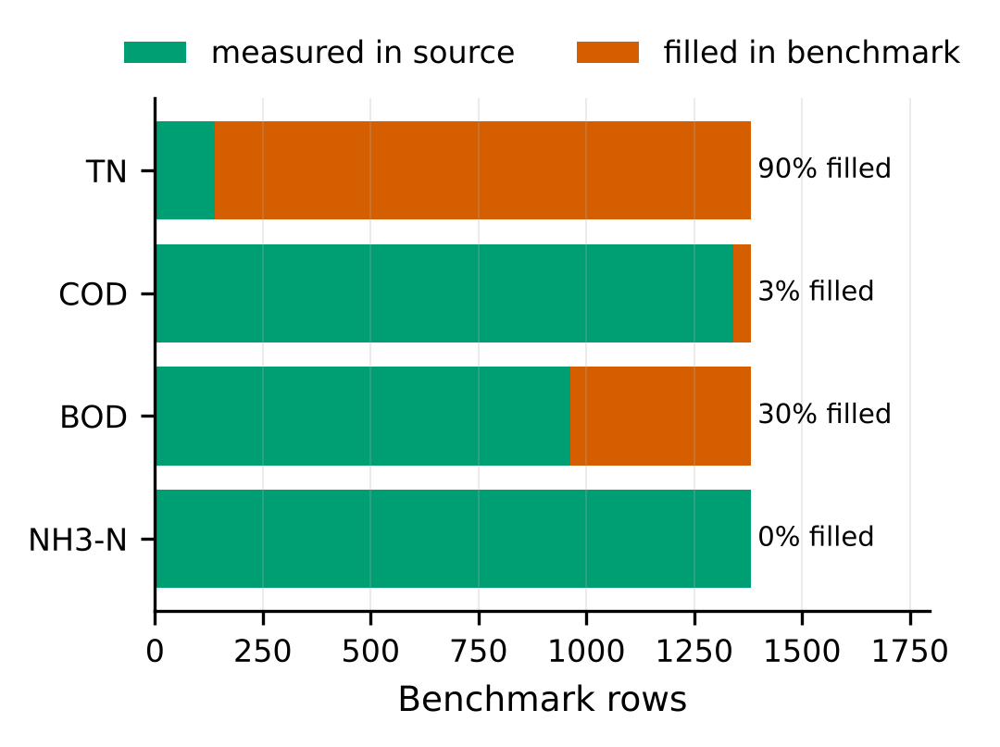
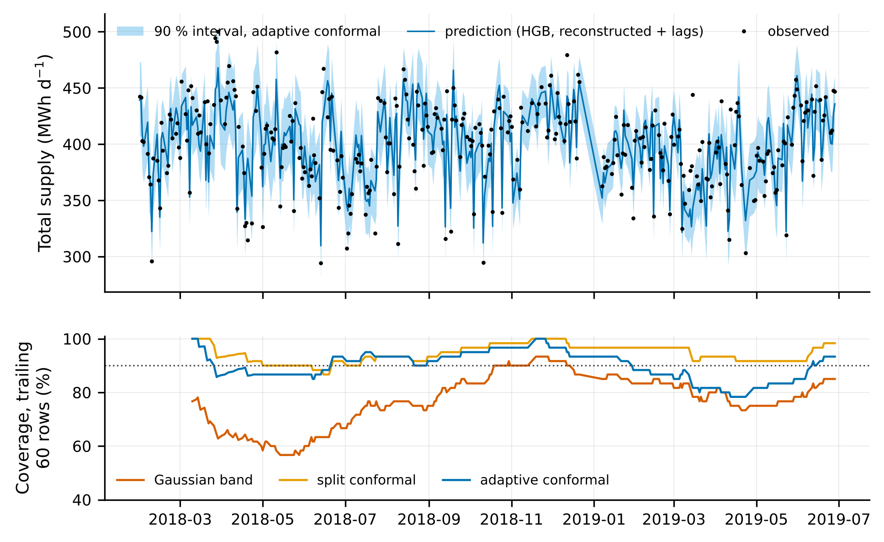
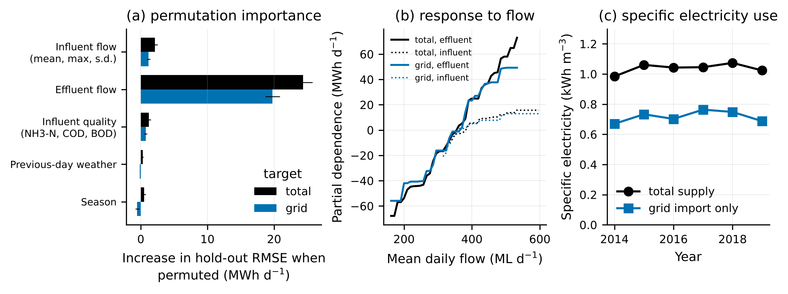

# Highlights

- A public WWTP energy benchmark was checked against its primary source tables.
- Both flow columns hold 2008–2012 values attached to 2014–2019 dates.
- The target is grid import only; 30 % of electricity supply is generated on site.
- With the file as distributed, no model beats a previous-day persistence forecast.
- Re-dated flows cut hold-out RMSE by 36 %; effluent pumping carries the signal.

# Abstract

Open datasets are scarce in wastewater engineering, so the few that exist become benchmarks. One, a daily table for Melbourne's Eastern Treatment Plant (1,382 rows, 2014–2019), has been used in at least six machine-learning studies of energy prediction. We compared this file column by column with its primary open-data tables, then repeated the prediction task on a reconstructed, date-consistent table. Four defects were found. (1) The target is grid import only; on-site generation, 30 % of electricity supply, is absent. (2) Both flow columns are daily means from 2008–2012 attached by row position to dates in 2014–2019 (r = 0.999 by row, 0.12 by date). (3) 90 % of total-nitrogen and 30 % of BOD values are fills, not measurements. (4) Each date label is one day earlier than the day its energy value describes. With the file as distributed, no model beat a previous-day persistence forecast on a chronological hold-out (RMSE 43.5 against 40.7 MWh d⁻¹), yet shuffled cross-validation returned R² = 0.31. Re-dating the two flow columns alone lowered RMSE to 27.8 MWh d⁻¹; adding true calendar lags gave 24.0 MWh d⁻¹ for grid import and 19.0 MWh d⁻¹ for total supply (MAPE 3.7 %). Effluent flow, pumped through a 56-km outfall, carried almost all the signal; a two-parameter line in it matched gradient boosting. Spline augmentation applied before splitting reproduced a published 1.4 % MAPE that copying the previous row also attains. Conformal intervals covered 90–95 % of hold-out days against 78 % for a Gaussian band.

**Keywords:** wastewater treatment plant; energy consumption; benchmark dataset; data provenance; data leakage; conformal prediction; effluent pumping

# 1. Introduction

Electricity is one of the largest operating costs of a wastewater treatment plant (WWTP), and its monitoring, benchmarking and reduction have been studied for decades (Longo et al., 2016; Gu et al., 2017; Cardoso et al., 2021). Data-driven models are now routinely proposed for predicting plant electricity use from flow, load and weather (Torregrossa et al., 2018; Harrou et al., 2021; Zhang et al., 2021; Oliveira et al., 2021), within a wider movement toward machine learning (ML) in wastewater operation (Newhart et al., 2019; Bahramian et al., 2023).

Full-scale operating data are rarely published, so the few open tables attract repeated use. A prominent example is the daily dataset for Melbourne Water's Eastern Treatment Plant (ETP) deposited on Mendeley Data (Bagherzadeh, 2021) and introduced by Bagherzadeh et al. (2021). It joins grid electricity, influent and effluent flow, influent quality and airport weather for 1,382 days between 2014 and 2019. The same file has since served as the test bed for comparisons of 15 to 23 ML models (Alali et al., 2022, 2023), deep learning with data augmentation (Harrou et al., 2023), a knowledge-enhanced graph network (Allen and Cordiner, 2025) and an interval type-2 neuro-fuzzy system (Khaled et al., 2026). Each study proposed a new model and reported lower errors than its predecessors.

Three issues have not been examined in this line of work. First, none of the studies compared the file with the primary Melbourne Water tables from which it was assembled, so the meaning and integrity of its columns rest on a single join performed in 2021. Second, none reported a naive reference such as the previous day's value, although such references are the standard yardstick for forecast skill (Hyndman and Koehler, 2006). Third, reported errors span almost one order of magnitude, from a mean absolute percentage error (MAPE) of 10–15 % (Alali et al., 2023; Khaled et al., 2026) to 1.4 % (Harrou et al., 2023), without an explanation of the difference. General reviews have warned that data leakage and inadequate splitting are widespread in environmental ML (Zhu et al., 2023) and across ML-based science (Kapoor and Narayanan, 2023), and that data handling is the weak link of the wastewater "data pipeline" (Therrien et al., 2020). Temporal data in particular require validation schemes that respect time order (Bergmeir and Benítez, 2012; Roberts et al., 2017). To our knowledge, however, no study has audited a specific wastewater benchmark against its sources and quantified what the defects do to model performance.

This paper does so for the ETP file. The objectives were (i) to verify every column of the benchmark against the primary open-data tables; (ii) to rebuild a date-consistent table from those sources, including on-site generation; (iii) to quantify how the benchmark's defects and the validation protocol change apparent model skill relative to naive baselines; and (iv) to give calibrated prediction intervals and an engineering interpretation of what drives daily electricity use at this plant. Four hypotheses, formulated after the audit and before the prediction experiments, were tested. H1: with the file as distributed, ML models do not outperform a previous-day persistence forecast under chronological validation. H2: correcting the data, without changing the algorithm, yields a larger gain than any algorithm change. H3: total electricity supply (grid plus on-site generation) is more predictable from process variables than grid import. H4: shuffled validation and augmentation before splitting inflate apparent accuracy.

# 2. Materials and methods

## 2.1 Plant

ETP, at Bangholme in south-east Melbourne, treats about 330 ML d⁻¹ (Bagherzadeh et al., 2021). Treated effluent leaves the site through an outfall pump station and a 56-km pipeline to Bass Strait (Melbourne Water, 2023). Biogas from anaerobic digestion fuels an on-site power station that supplies about 30 % of the plant's electricity (Melbourne Water, n.d.).

## 2.2 Data sources

Six files were used (Table S0 lists sizes and SHA-256 checksums).

*Benchmark.* `Data-Melbourne_F.csv` (Bagherzadeh, 2021; CC BY 4.0), 1,382 rows and 20 columns: outflow, inflow, grid electricity (`total_grid`), ammonia, BOD, COD, total nitrogen (TN), ten weather fields and the date. The downloaded file matches the checksum published by the repository.

*Primary tables.* Five feature services of the Melbourne Water Open Data Hub were retrieved in full on 12 November 2026 through their public REST interface: daily grid electricity by feeder with on-site generation (2,588 days, 1 January 2014 to 31 January 2021); daily influent quality (1,382 samples); daily effluent quality (1,716 records); and hourly influent and effluent flow from 2009 (91,993 and 93,529 records). The Victorian government data catalogue lists the electricity, flow and influent-quality tables under a CC BY 4.0 licence (DataVic, 2024a–d); the licence of the effluent-quality table, which is used here only for one descriptive indicator, was not confirmed. According to the catalogue, the effluent series is the hourly flow rate at the plant's outfall pump station, and influent samples are flow-weighted 24-h composites collected at 07:00 that relate to the preceding 24 h.

## 2.3 Provenance audit

Each benchmark column was compared with its source. For electricity, the benchmark value was matched to the sum of the two grid feeders. For flows, daily means of the hourly source series were compared with the benchmark values under three alignments: the same calendar date, the following date, and row position (the *i*-th benchmark row against the *i*-th day of the source series). For quality variables, rows were classed as measured (a value exists in the source and equals the benchmark) or filled (no source value). Weather fields have no primary table in this study; they were screened for impossible values and for seasonal and event plausibility.

The electricity records are stamped at local midnight. To establish which 24 h each record covers, we correlated day-to-day changes in electricity with day-to-day changes in the mean of 24-h hourly-flow windows starting between −48 h and +36 h from the stamp.

## 2.4 Reconstructed table

All records were keyed to the local calendar day (Australia/Melbourne) that they describe: electricity to the day starting at its stamp (Section 3.1), hourly flows aggregated to local days with at least 20 valid hours (mean, maximum, standard deviation), and quality samples to the local date of their 07:00 stamp, which is the pairing used in the benchmark file. Because a composite collected at 07:00 covers mainly the previous day, the alternative pairing of each day with the sample collected the next morning was run as a sensitivity analysis. Grid import, on-site generation and their sum (hereafter total supply) were kept as separate series. Quality values were used only where measured; nothing was imputed in the table. The benchmark's weather fields were retained except sea-level pressure, visibility and gust, which failed screening (Section 3.1); because of the one-day label offset they are the previous day's weather. The effluent meter reported whole-day means below 10 % of the same-day influent mean on 21 days, 18 of them exactly zero, including 17 consecutive days in March 2019 during which inflow and electricity were normal. Such values are incompatible with a plant mass balance and were set to missing; all results are also reported without this screen.

## 2.5 Prediction experiments

*Targets.* Daily grid import and daily total supply (MWh d⁻¹).

*Feature sets.* **BM**: the 16 predictors of the benchmark file plus an annual harmonic, as distributed. **BM-flowfix**: BM with the two flow columns replaced by correctly dated daily means, everything else unchanged. **RC**: reconstructed inputs (influent mean, maximum and standard deviation; effluent mean; measured NH₃-N, COD and BOD; seven weather fields; annual harmonic). **RC-noflow**: RC without the four flow variables. **LAG**: target on the previous day, seven days earlier and the mean of the previous seven days, plus the harmonic. **RC-dyn**: RC plus the LAG variables. **BM-rowlag**: BM plus the target of the previous *row*, which is how lagged energy can be built from the file alone; 23 % of rows are not preceded by the previous calendar day (gaps of 2–20 days).

*Models.* Ridge regression; random forest (Breiman, 2001; 300 trees); histogram gradient boosting (HGB; Friedman, 2001), tuned over 12 configurations by three-fold expanding-window validation inside the training data. All models used scikit-learn 1.9.1 (Pedregosa et al., 2011). Missing predictors were handled natively by HGB and by training-set median imputation with missingness indicators for the other two.

*Naive references.* Previous-day value (persistence), value seven days earlier, mean of the previous seven days, training mean and training monthly mean.

*Validation.* The primary protocol is the chronological hold-out used by the earlier studies: benchmark labels up to 28 January 2018 for training (1,032 rows) and later rows for testing (346 rows). The same models were also evaluated by shuffled five-fold cross-validation and by five-fold rolling-origin validation, with tuning nested inside each fold.

*Metrics and tests.* RMSE, MAE, MAPE, R², skill relative to persistence (1 − RMSE/RMSE of persistence) and MASE (Hyndman and Koehler, 2006). Forecasts were compared with the Diebold–Mariano test (Diebold and Mariano, 1995) with the small-sample correction of Harvey et al. (1997), and with 95 % moving-block bootstrap intervals (blocks of 14 rows, 2,000 resamples).

## 2.6 Augmentation experiment

Harrou et al. (2023) enlarged the 1,382 rows ten-fold by cubic-spline interpolation, then split the augmented table chronologically and used lagged energy as an input. We emulated this order of operations with the BM columns and HGB, and compared it with no augmentation and with augmentation of the training period only. The emulation follows the description in that paper; their code was not available to us.

## 2.7 Prediction intervals

Nominal 90 % intervals were built on the hold-out for HGB with RC and RC-dyn inputs by four methods: a Gaussian band of ±1.645 in-sample residual standard deviations; split conformal prediction (Angelopoulos and Bates, 2023), calibrated on the most recent 20 % of the training period; conformalized quantile regression (Romano et al., 2019); and adaptive conformal inference (Gibbs and Candès, 2021; step 0.02, trailing pool of 250 residuals). Coverage, mean width and the interval (Winkler) score are reported.

## 2.8 Interpretation and out-of-time check

Permutation importance was computed on the hold-out for groups of related inputs, which avoids splitting importance among correlated columns. A two-parameter engineering baseline, E = a + b·Q, was fitted by least squares on the training period, with block-bootstrap intervals. Specific electricity use was computed per cubic metre of influent and per kilogram of COD removed. Finally, because the primary electricity table extends 19 months beyond the benchmark (to 31 January 2021), lag-only models trained on days up to 29 January 2018 were evaluated separately on that later window.

All steps are scripted in Python 3.13; the full pipeline runs in about six minutes on two CPU cores.

# 3. Results

## 3.1 What the benchmark file contains

Table 1 summarises the audit.

**Table 1.** Comparison of the benchmark file with the primary Melbourne Water tables.

| Column(s) | Finding | Evidence |
|---|---|---|
| `total_grid` (target) | Equals feeder 1 + feeder 2, i.e. grid import. On-site generation is not included. | Exact match in 1,380 of 1,382 rows. Generation averages 115.8 MWh d⁻¹ against 275.1 MWh d⁻¹ of grid import (29.9 % of supply); r(grid, generation) = −0.33. |
| `avg_inflow`, `avg_outflow` | Daily means of flows from 31 Dec 2008 to Oct 2012, attached by row position to dates in 2014–2019. | Inflow: r = 0.999 by row position over all 1,382 rows; r = 0.12 on the day described and 0.10–0.11 on the label date. Outflow: r = 0.999 by row for the first 700 rows, decaying thereafter; r = 0.20 by date. |
| `TN` | 90.0 % of values are fills. | TN was measured on 138 of the 1,382 sample days. |
| `BOD` | 30.4 % of values are fills. | All 420 filled values equal COD/2 exactly. |
| `COD`, `Am` | 3.0 % and 0.1 % fills. | 42 and 1 rows without a source value. |
| `SLP`, `VV`, `VG` | Not usable. | Pressure is 0 in 1,377 rows; visibility reaches 512 km (27 rows above 50 km); gust is 0 in 51.8 % of rows. |
| date | Label is one day earlier than the local day described by the energy value. | Correlation of day-to-day changes between total supply and a 24-h effluent-flow window peaks at 0.88 when the window starts at the record stamp, and is −0.33 for the preceding 24 h (Fig. S1). |

The target of every earlier study is therefore net grid import. Total supply rose from 375 MWh d⁻¹ in 2014 to 430 MWh d⁻¹ in 2020, while the generation share stayed near 30 %, with a dip to 27 % in 2017 (Fig. 1). Because generation varies independently of treatment load, it adds variance to grid import that process variables cannot explain; the variance of generation is 20 % of the variance of grid import.

{width=85%}

The flow finding is the most consequential. The first benchmark row, labelled 1 January 2014, carries an inflow of 2.589 kL s⁻¹, which is the mean of the first eleven hourly records of the source series on 31 December 2008; the following rows track the following days of 2009 (Fig. 2c). The benchmark's inflow and outflow thus describe a period five years before the dates to which they are attached, with no physical relation to the electricity values beside them.

{width=95%}

{width=50%}

## 3.2 Skill with the file as distributed

On the chronological hold-out, persistence gave an RMSE of 40.7 MWh d⁻¹ (MAPE 10.5 %) for grid import (Table 2). No model trained on the BM inputs did better: HGB reached 43.5 MWh d⁻¹ (R² = −0.13), random forest 44.5 and ridge 44.6, none significantly different from persistence (Diebold–Mariano p = 0.17–0.38). Adding the previous row's energy brought HGB to 37.0 MWh d⁻¹, about 9 % better than persistence and no better than three lag variables alone (35.5 MWh d⁻¹). H1 is supported.

These figures are close to those published for the same split: RMSE 33.9–39.8 MWh d⁻¹ with R² of 0.00–0.18 (Bagherzadeh et al., 2021), 37.1–41.4 MWh d⁻¹ (Alali et al., 2023), 37.8 MWh d⁻¹ without augmentation (Harrou et al., 2023) and 35.3–51.5 MWh d⁻¹ (Khaled et al., 2026). The earlier studies removed about 5 % of rows as outliers, so the comparison is approximate, but the published errors sit in the range that a persistence forecast attains.

**Table 2.** Chronological hold-out (346 rows). HGB unless stated; 95 % block-bootstrap interval for RMSE in brackets; skill is relative to persistence.

| Inputs | Grid import: RMSE (MWh d⁻¹) | MAPE (%) | R² | Skill (%) | Total supply: RMSE (MWh d⁻¹) | MAPE (%) | R² | Skill (%) |
|---|---|---|---|---|---|---|---|---|
| Persistence | 40.7 [36.3, 45.5] | 10.5 | 0.01 | 0 | 40.3 [36.0, 44.5] | 7.3 | −0.16 | 0 |
| Mean of previous 7 d | 39.7 | 11.3 | 0.06 | 2 | 35.9 | 7.1 | 0.08 | 11 |
| BM (file as distributed) | 43.5 [37.1, 51.0] | 12.7 | −0.13 | −7 | 39.1 [33.6, 44.2] | 7.8 | −0.10 | 3 |
| BM-rowlag | 37.0 | 10.5 | 0.18 | 9 | 35.3 | 7.0 | 0.11 | 12 |
| BM-flowfix | 27.8 [23.1, 33.3] | 7.7 | 0.54 | 32 | 23.3 [18.4, 28.5] | 4.4 | 0.61 | 42 |
| RC-noflow | 45.2 | 13.3 | −0.22 | −11 | 40.8 | 8.2 | −0.19 | −1 |
| RC | 28.0 [23.1, 33.6] | 7.7 | 0.53 | 31 | 22.7 [17.6, 28.1] | 4.2 | 0.63 | 44 |
| LAG | 35.5 | 10.0 | 0.25 | 13 | 33.1 | 6.5 | 0.21 | 18 |
| RC-dyn | 24.0 [20.5, 28.1] | 6.6 | 0.66 | 41 | 19.0 [16.4, 22.3] | 3.7 | 0.74 | 53 |
| RC-dyn, ridge | 24.2 | 6.6 | 0.65 | 41 | 18.6 | 3.6 | 0.75 | 54 |
| RC-dyn, random forest | 24.1 | 6.9 | 0.65 | 41 | 18.7 | 3.7 | 0.75 | 54 |

## 3.3 Effect of correcting the data

Replacing only the two misdated flow columns (BM-flowfix) lowered the HGB hold-out RMSE for grid import from 43.5 to 27.8 MWh d⁻¹, a change of −15.7 MWh d⁻¹ (95 % interval −20.1 to −11.1; Diebold–Mariano p < 0.001), and raised R² from −0.13 to 0.54 (Fig. 4a). The fully reconstructed inputs gave the same result (28.0 MWh d⁻¹), and removing the flows from them returned the error to the level of the benchmark file (45.2 MWh d⁻¹). The other corrections — dropping the filled TN, the defective weather fields and the COD/2 fills — had no measurable effect on accuracy; their importance lies in interpretation (Section 4).

With calendar-true lags added (RC-dyn), RMSE fell to 24.0 MWh d⁻¹ for grid import and 19.0 MWh d⁻¹ for total supply, 41 % and 53 % better than persistence. Among algorithms, the spread was small: for RC-dyn the three model families lay within 0.2 MWh d⁻¹ (grid) and 0.4 MWh d⁻¹ (total) of each other, against a 13–16 MWh d⁻¹ gain from the data correction. H2 is supported.

Total supply was predicted better than grid import in every configuration that contained real signal (R² 0.63 against 0.53 for RC; 0.74 against 0.66 for RC-dyn; MAPE 3.7 % against 6.6 %), which supports H3. Without the mass-balance screen on the effluent meter, RC-dyn gave 25.3 (grid) and 22.5 MWh d⁻¹ (total); the differences from the screened results were not significant (p = 0.20 and 0.15), and none of the conclusions changes. Pairing each day with the composite sample collected the next morning (available for 1,036 of the 1,378 rows) changed the HGB hold-out RMSE by +0.1 to +0.6 MWh d⁻¹ (p = 0.08–0.54).

{width=95%}

## 3.4 Effect of the validation protocol

With the BM inputs, shuffled five-fold cross-validation gave R² = 0.31 for grid import, whereas rolling-origin validation gave −0.04 and the chronological hold-out −0.13 (Table 3, Fig. 4b). The shuffled estimate credits the models with interpolating slow level changes between neighbouring days, which is unavailable in operation. For inputs that contain real signal the gap narrows but remains (RC: 0.63 shuffled against 0.48–0.53 in time order).

**Table 3.** R² of HGB for grid import under three validation protocols.

| Inputs | Shuffled 5-fold | Rolling origin | Chronological hold-out |
|---|---|---|---|
| BM | 0.31 | −0.04 | −0.13 |
| BM-rowlag | 0.40 | 0.27 | 0.18 |
| RC | 0.63 | 0.48 | 0.53 |
| RC-dyn | 0.73 | 0.68 | 0.66 |

The augmentation experiment gave a sharper result (Table 4, Fig. 4c). Interpolating the whole table ten-fold before the chronological split and feeding the model the previous (interpolated) row produced a test MAPE of 1.35 %, RMSE of 4.9 MWh d⁻¹ and R² of 0.985. The values reported for this procedure by Harrou et al. (2023) are 1.36 %, 5.8 MWh d⁻¹ and 0.978. Copying the previous interpolated row, with no model, gave 1.29 %. When the split preceded augmentation and the untouched test rows were scored, MAPE was 11.6 %, the same as copying the previous row of the file. The low error is therefore a property of the smooth interpolant between adjacent real observations and carries no information on predictive skill. H4 is supported.

**Table 4.** Ten-fold cubic-spline augmentation, grid import, BM inputs with lagged energy (HGB).

| Order of operations | Test rows | MAPE (%) | RMSE (MWh d⁻¹) | R² | MAPE of copying the previous row (%) |
|---|---|---|---|---|---|
| No augmentation | 346 | 11.1 | 38.0 | 0.14 | 11.6 |
| Augment all rows, then split | 3,460 | 1.35 | 4.9 | 0.985 | 1.29 |
| Split, then augment training rows only | 346 | 11.6 | 43.1 | −0.11 | 11.6 |

## 3.5 Prediction intervals

The Gaussian band covered 78 % (total supply) and 86 % (grid import) of hold-out days at a nominal 90 %, and less over some stretches of the hold-out (Fig. 5), because in-sample residuals of a flexible model understate out-of-sample error. Split conformal intervals were conservative (93.4–95.4 %), conformalized quantile regression was close to nominal (89.0–95.1 %), and adaptive conformal inference held 89.9–91.0 % in all four cases with the narrowest valid intervals (57 MWh d⁻¹ mean width for total supply with RC-dyn, about ±7 % of the mean).

**Table 5.** Nominal 90 % intervals on the hold-out, HGB with RC-dyn inputs.

| Method | Grid: coverage (%) | Mean width (MWh d⁻¹) | Total: coverage (%) | Mean width (MWh d⁻¹) |
|---|---|---|---|---|
| Gaussian band, in-sample residuals | 85.8 | 65.0 | 78.3 | 42.9 |
| Split conformal | 93.6 | 86.7 | 94.8 | 68.4 |
| Conformalized quantile regression | 89.0 | 82.3 | 91.6 | 69.5 |
| Adaptive conformal inference | 91.0 | 80.7 | 90.5 | 57.1 |

{width=85%}

## 3.6 What drives daily electricity use

Permuting effluent flow raised the hold-out RMSE by 24.4 MWh d⁻¹ for total supply and 19.8 MWh d⁻¹ for grid import; no other input group contributed more than 2.1 MWh d⁻¹ (influent flow 2.1, influent quality 1.2, weather 0.3, season 0.5 for total supply; Fig. 6a). The response to effluent flow is close to linear over the observed range (Fig. 6b). The engineering baseline fitted on the training period was

E_total = 238 (228–250) + 0.43 (0.40–0.46) · Q_eff,

with E in MWh d⁻¹ and Q_eff in ML d⁻¹, so that the slope is in kWh m⁻³. On the hold-out this line gave an RMSE of 23.3 MWh d⁻¹ (R² = 0.61, MAPE 4.6 %), the same as HGB with all 16 reconstructed inputs (22.7 MWh d⁻¹). The same line in influent flow explained almost nothing (hold-out R² = 0.02). About 61 % of supply at mean flow is a flow-independent base load.

Median specific electricity use was 1.04 kWh m⁻³ of influent on the basis of total supply and 0.72 kWh m⁻³ on the basis of grid import (1.26 against 0.88 kWh per kg COD removed). An indicator computed from the benchmark target would understate the plant's electricity intensity by 31 % (Fig. 6c).

{width=95%}

## 3.7 Out-of-time check

For the 583 days after the benchmark ends (29 June 2019 to 31 January 2021), only electricity is published. A ridge model on lagged values, trained on data up to January 2018, kept its advantage over persistence in this later window (grid import: skill 11.8 % inside the benchmark period and 12.8 % after it; total supply: 13.9 % and 13.4 %; all p < 0.001), and its split-conformal 90 % intervals covered 89.7 % (grid) and 86.1 % (total) of days. The modest size of this skill confirms that most of the predictability reported in Section 3.3 comes from the flow information, not from autocorrelation (lag-1 autocorrelation is 0.68 for grid import).

# 4. Discussion

**The benchmark carried almost no usable signal.** In the file as distributed, the only inputs with a physical link to the dated electricity values were ammonia, measured COD, about two-thirds of the BOD values, a tenth of the TN values and the previous day's weather. These proved to be weak predictors: the reconstructed inputs without flow did no better than the training mean. This explains why six studies using increasingly elaborate models reported R² values near zero or errors near 10–13 % on the chronological split: they were, in effect, competing to model noise around a slowly drifting level. It also explains why lagged energy appeared so valuable in those studies (Alali et al., 2023; Harrou et al., 2023), since it was the one informative input.

**Earlier feature rankings need re-reading.** TN was reported as the most influential variable (Bagherzadeh et al., 2021), yet nine in ten TN values are fills whose rule is undocumented, and inflow was ranked among the top variables although the column belongs to another period. Importance scores computed from training-set impurity can assign weight to such columns; in our chronological evaluation neither improved predictions. We suggest that process conclusions drawn from the benchmark (for example, that nitrogen load governs energy use at ETP) should not be relied upon.

**Effluent pumping, not biological load, governs day-to-day variation.** Once correctly dated, effluent flow alone explained 61 % of hold-out variance in total supply, and influent flow almost none. This is consistent with the plant layout: the effluent series is metered at the outfall pump station (DataVic, 2024c), which lifts treated effluent into a 56-km pipeline, and storage on site decouples the hourly discharge from the hourly inflow. The slope of 0.43 kWh m⁻³ is of the order expected for a long transfer main; the base load of about 240 MWh d⁻¹ covers aeration, tertiary treatment and solids handling, whose day-to-day variation was not resolved by influent NH₃-N, COD or BOD. The practical reading is that short-term electricity forecasts at this plant are, to first order, forecasts of the effluent pumping schedule, which the operator controls. Variables that would resolve the remaining 25–35 % of variance (blower air flow, dissolved-oxygen set-points, ozone dose, sludge processing) are not in the open tables.

**The target matters for both prediction and benchmarking.** Grid import is what the utility pays for, and it is a legitimate target for procurement. It is, however, the difference between demand and on-site generation, and generation depends on digester gas production and engine availability. Models that aim to explain energy use from treatment variables should use total supply; models of grid import should include generation or its drivers. Intensity indicators built on the benchmark target are about 30 % too low and are not comparable with plants that have no generation (Longo et al., 2016; Gu et al., 2017).

**Simple references would have exposed the problem.** A previous-day forecast, a two-parameter line and a time-ordered split are each a few lines of code. Had they been reported alongside the first models, the absence of skill would have prompted a look at the inputs. The augmentation case is instructive for another reason: the 1.4 % MAPE is reproduced by copying the previous interpolated row, so any model given that row will appear excellent. Interpolated points are functions of their real neighbours on both sides, and a chronological split does not separate them. These observations agree with general accounts of leakage (Kapoor and Narayanan, 2023; Zhu et al., 2023) and extend them with a quantified wastewater example.

**Uncertainty should be validated, not asserted.** The band used with the original study, a normal-theory interval on residuals, was not checked for coverage. In our re-evaluation a comparable band under-covered by 4–12 points, whereas conformal methods, which need only a held-out calibration set, were close to nominal and remained so under the gradual upward drift of demand when updated online.

**Recommendations.** For dataset publishers: deposit the join script with the table; keep measured and filled values distinguishable; state the time zone and whether a daily stamp marks the start or end of the day. For users: verify a sample of rows against the primary source, report persistence and a physically motivated baseline, split in time before any transformation that mixes rows, and report interval coverage. For this dataset: use the reconstructed table released with this paper, or rebuild it from the primary tables with the scripts provided.

# 5. Practical implications

For Melbourne Water and similar utilities, a forecast of next-day total supply within about ±7 % (90 % interval) is attainable from the planned effluent discharge and recent demand alone, without influent quality measurements. For researchers, the reconstructed ETP table offers a small but sound test bed with a documented difficulty level: persistence RMSE 40 MWh d⁻¹, flow-line baseline 23 MWh d⁻¹, best dynamic model 19 MWh d⁻¹ for total supply. New methods should be judged by how far they move beyond these three reference points on the chronological split.

# 6. Limitations

The study concerns one plant and one benchmark; the prevalence of similar defects elsewhere is unknown. Weather fields could not be compared with a primary meteorological record and were only screened. We infer the row-position join from the data; the original processing script was not available, and the primary tables may have been revised since the benchmark was compiled in 2021, although the flow correspondence (r = 0.999 over 1,382 rows) leaves little room for an alternative explanation. Influent quality contributed little under either pairing of composite samples with days, so its small importance is not an artefact of sample timing, but it may reflect the absence of load variables at sub-daily resolution. The mass-balance screen on the effluent meter was defined after the anomaly was noticed in hold-out predictions; results without it are reported. Only models available in scikit-learn were run, and no deep networks; since the conclusions concern data and validation, we do not expect them to depend on this choice, but it was not tested. Hyper-parameter search was deliberately small. The emulation of the augmentation procedure follows a published description and may differ in detail from the original implementation. The authors of the benchmark and of the cited studies have not yet been consulted and should be given the opportunity to respond before publication.

# 7. Conclusions

1. The public ETP energy benchmark differs from its primary sources in four ways: an incomplete target, misdated flow columns, undisclosed fills and a one-day label offset.
2. With the file as distributed, no tested model outperforms a previous-day persistence forecast under chronological validation; shuffled validation and augmentation before splitting conceal this.
3. Correcting the flow dates, without changing the algorithm, reduces the hold-out RMSE for grid import by 36 %; with calendar-true lags, total supply is predicted with an RMSE of 19 MWh d⁻¹ (MAPE 3.7 %), 53 % better than persistence.
4. Effluent pumping explains most of the predictable day-to-day variation; a two-parameter line in effluent flow equals gradient boosting on 16 inputs.
5. Conformal intervals attain their nominal coverage on unseen days, whereas a Gaussian residual band does not.

# Data availability statement

The benchmark file is available from Mendeley Data (https://doi.org/10.17632/pprkvz3vbd.1, CC BY 4.0). The primary tables are available from the Melbourne Water Open Data Hub (https://data-melbournewater.opendata.arcgis.com; services `MWC_ETP_Daily_ElectricityUse_From2014`, `MWC_ETP_Daily_InfluentQuality_From2014`, `MWC_ETP_Daily_EffluentQuality_From2014`, `MWC_ETP_Hourly_InfluentFlow_From2009`, `MWC_ETP_Hourly_EffluentFlow_From2009`). The copies used here, their SHA-256 checksums and the reconstructed daily table are provided with the code in a public repository (https://github.com/phamnam123lite-svg/etp-energy-benchmark-audit), and an archived release with a DOI will be created on acceptance. The data are redistributed with attribution to Melbourne Water and to Bagherzadeh (2021).

# Code availability statement

All Python scripts (`01_build_dataset.py` to `08_summary_figures.py`, `run_all.py`), the list of library versions and all result tables are in the same repository under the MIT licence. `python run_all.py` regenerates every table and figure from the raw files in about six minutes. No proprietary software was used.

# CRediT authorship contribution statement

**Viet Nam Tran:** Conceptualization, Methodology, Formal analysis, Data curation, Validation, Writing – review and editing. [To be adjusted by the author to reflect the actual division of work; see the declaration below.]

# Declaration of generative AI in the research and writing process

During the preparation of this work the author used Claude (Anthropic) to search the literature, retrieve the open data, write and run the analysis code, and draft the text and figures. The author reviewed and edited the content as needed and takes full responsibility for the content of the publication. [The author must check every result and reference before this statement is submitted, and adapt the wording to the target journal's policy.]

# Funding

[To be completed by the author.]

# Declaration of competing interest

[To be completed by the author.]

# References

Alali, Y., Harrou, F., Sun, Y., 2022. Predicting energy consumption in wastewater treatment plants through light gradient boosting machine: a comparative study. 2022 10th International Conference on Systems and Control (ICSC), 137–142. https://doi.org/10.1109/ICSC57768.2022.9993872

Alali, Y., Harrou, F., Sun, Y., 2023. Unlocking the potential of wastewater treatment: machine learning based energy consumption prediction. Water 15 (13), 2349. https://doi.org/10.3390/w15132349

Allen, L., Cordiner, J., 2025. Knowledge-enhanced data-driven modeling of wastewater treatment processes for energy consumption prediction. Comput. Chem. Eng. 194, 108982. https://doi.org/10.1016/j.compchemeng.2024.108982

Angelopoulos, A.N., Bates, S., 2023. Conformal prediction: a gentle introduction. Found. Trends Mach. Learn. 16 (4), 494–591. https://doi.org/10.1561/2200000101

Bagherzadeh, F., 2021. Full scale wastewater treatment plant data. Mendeley Data, V1. https://doi.org/10.17632/pprkvz3vbd.1

Bagherzadeh, F., Nouri, A.S., Mehrani, M.-J., Thennadil, S., 2021. Prediction of energy consumption and evaluation of affecting factors in a full-scale WWTP using a machine learning approach. Process Saf. Environ. Prot. 154, 458–466. https://doi.org/10.1016/j.psep.2021.08.040

Bahramian, M., Dereli, R.K., Zhao, W., Giberti, M., Casey, E., 2023. Data to intelligence: the role of data-driven models in wastewater treatment. Expert Syst. Appl. 217, 119453. https://doi.org/10.1016/j.eswa.2022.119453

Bergmeir, C., Benítez, J.M., 2012. On the use of cross-validation for time series predictor evaluation. Inf. Sci. 191, 192–213. https://doi.org/10.1016/j.ins.2011.12.028

Breiman, L., 2001. Random forests. Mach. Learn. 45 (1), 5–32. https://doi.org/10.1023/A:1010933404324

Cardoso, B.J., Rodrigues, E., Gaspar, A.R., Gomes, Á., 2021. Energy performance factors in wastewater treatment plants: a review. J. Clean. Prod. 322, 129107. https://doi.org/10.1016/j.jclepro.2021.129107

DataVic, 2024a. Melbourne Wastewater Treatment (East) – Daily Grid Electricity Consumption. Melbourne Water Corporation. https://discover.data.vic.gov.au/dataset/melbourne-wastewater-treatment-east-daily-grid-electricity-consumption (accessed 12 November 2026)

DataVic, 2024b. Wastewater Inlet – Hourly Flow – Eastern Treatment Plant (ETP). Melbourne Water Corporation. https://discover.data.vic.gov.au/dataset/wastewater-inlet-hourly-flow-eastern-treatment-plant-etp (accessed 12 November 2026)

DataVic, 2024c. Wastewater Outlet – Hourly Flow – Eastern Treatment Plant (ETP). Melbourne Water Corporation. https://discover.data.vic.gov.au/dataset/wastewater-outlet-hourly-flow-eastern-treatment-plant-etp (accessed 12 November 2026)

DataVic, 2024d. Wastewater Inlet – Daily Raw Water Quality – Eastern Treatment Plant (ETP). Melbourne Water Corporation. https://discover.data.vic.gov.au/dataset/wastewater-inlet-daily-raw-water-quality-eastern-treatment-plant-etp (accessed 12 November 2026)

Diebold, F.X., Mariano, R.S., 1995. Comparing predictive accuracy. J. Bus. Econ. Stat. 13 (3), 253–263. https://doi.org/10.1080/07350015.1995.10524599

Friedman, J.H., 2001. Greedy function approximation: a gradient boosting machine. Ann. Stat. 29 (5), 1189–1232. https://doi.org/10.1214/aos/1013203451

Gibbs, I., Candès, E., 2021. Adaptive conformal inference under distribution shift. Adv. Neural Inf. Process. Syst. 34.

Gu, Y., Li, Y., Li, X., Luo, P., Wang, H., Robinson, Z.P., Wang, X., Wu, J., Li, F., 2017. The feasibility and challenges of energy self-sufficient wastewater treatment plants. Appl. Energy 204, 1463–1475. https://doi.org/10.1016/j.apenergy.2017.02.069

Harrou, F., Cheng, T., Sun, Y., Leiknes, T., Ghaffour, N., 2021. A data-driven soft sensor to forecast energy consumption in wastewater treatment plants: a case study. IEEE Sens. J. 21 (4), 4908–4917. https://doi.org/10.1109/JSEN.2020.3030584

Harrou, F., Dairi, A., Dorbane, A., Sun, Y., 2023. Energy consumption prediction in water treatment plants using deep learning with data augmentation. Results Eng. 20, 101428. https://doi.org/10.1016/j.rineng.2023.101428

Harvey, D., Leybourne, S., Newbold, P., 1997. Testing the equality of prediction mean squared errors. Int. J. Forecast. 13 (2), 281–291. https://doi.org/10.1016/S0169-2070(96)00719-4

Hyndman, R.J., Koehler, A.B., 2006. Another look at measures of forecast accuracy. Int. J. Forecast. 22 (4), 679–688. https://doi.org/10.1016/j.ijforecast.2006.03.001

Kapoor, S., Narayanan, A., 2023. Leakage and the reproducibility crisis in machine-learning-based science. Patterns 4 (9), 100804. https://doi.org/10.1016/j.patter.2023.100804

Khaled, Q., Mallak, B., Kaymak, U., Genga, L., 2026. Explainable uncertainty quantification for wastewater treatment energy prediction via interval type-2 neuro-fuzzy system. arXiv:2601.18897.

Longo, S., d'Antoni, B.M., Bongards, M., Chaparro, A., Cronrath, A., Fatone, F., Lema, J.M., Mauricio-Iglesias, M., Soares, A., Hospido, A., 2016. Monitoring and diagnosis of energy consumption in wastewater treatment plants. A state of the art and proposals for improvement. Appl. Energy 179, 1251–1268. https://doi.org/10.1016/j.apenergy.2016.07.043

Melbourne Water, 2023. Major Hazard Facility Safety Case Summary: Eastern Treatment Plant, March 2023. https://melbournewater.com.au/media/21291/download

Melbourne Water, n.d. Melbourne Water wins Earth Award for bioenergy project. https://www.melbournewater.com.au/node/8231 (accessed 12 November 2026)

Newhart, K.B., Holloway, R.W., Hering, A.S., Cath, T.Y., 2019. Data-driven performance analyses of wastewater treatment plants: a review. Water Res. 157, 498–513. https://doi.org/10.1016/j.watres.2019.03.030

Oliveira, P., Fernandes, B., Analide, C., Novais, P., 2021. Forecasting energy consumption of wastewater treatment plants with a transfer learning approach for sustainable cities. Electronics 10 (10), 1149. https://doi.org/10.3390/electronics10101149

Pedregosa, F., et al., 2011. Scikit-learn: machine learning in Python. J. Mach. Learn. Res. 12, 2825–2830.

Roberts, D.R., Bahn, V., Ciuti, S., Boyce, M.S., Elith, J., Guillera-Arroita, G., Hauenstein, S., Lahoz-Monfort, J.J., Schröder, B., Thuiller, W., Warton, D.I., Wintle, B.A., Hartig, F., Dormann, C.F., 2017. Cross-validation strategies for data with temporal, spatial, hierarchical, or phylogenetic structure. Ecography 40 (8), 913–929. https://doi.org/10.1111/ecog.02881

Romano, Y., Patterson, E., Candès, E., 2019. Conformalized quantile regression. Adv. Neural Inf. Process. Syst. 32.

Therrien, J.-D., Nicolaï, N., Vanrolleghem, P.A., 2020. A critical review of the data pipeline: how wastewater system operation flows from data to intelligence. Water Sci. Technol. 82 (12), 2613–2634. https://doi.org/10.2166/wst.2020.393

Torregrossa, D., Leopold, U., Hernández-Sancho, F., Hansen, J., 2018. Machine learning for energy cost modelling in wastewater treatment plants. J. Environ. Manage. 223, 1061–1067. https://doi.org/10.1016/j.jenvman.2018.06.092

Zhang, S., Wang, H., Keller, A.A., 2021. Novel machine learning-based energy consumption model of wastewater treatment plants. ACS ES&T Water 1 (12), 2531–2540. https://doi.org/10.1021/acsestwater.1c00283

Zhu, J.-J., Yang, M., Ren, Z.J., 2023. Machine learning in environmental research: common pitfalls and best practices. Environ. Sci. Technol. 57 (46), 17671–17689. https://doi.org/10.1021/acs.est.3c00026
