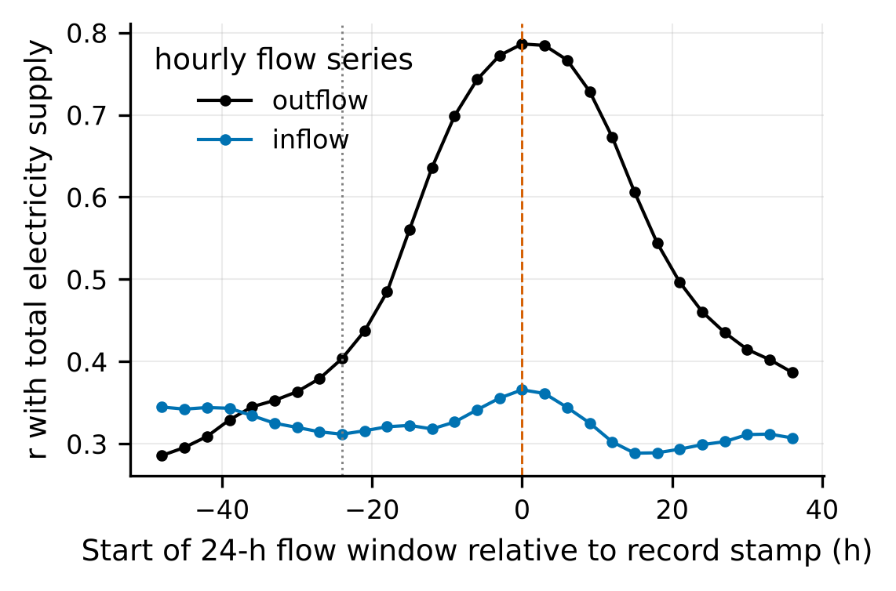

All tables are generated by `code/11_make_supplement.py` from the CSV files in `results/tables/`.

# Table S0. Raw files and checksums

| file | bytes | sha256 | matches_reference |
|---|---|---|---|
| Data-Melbourne_F.csv | 113941 | 323dcf40bdc91ea1… | True |
| MWC_ETP_Daily_ElectricityUse_From2014.csv | 108475 | 65969ab6f60be476… | True |
| MWC_ETP_Daily_InfluentQuality_From2014.csv | 42817 | 754c7cd6fac4705a… | True |
| MWC_ETP_Daily_EffluentQuality_From2014.csv | 77186 | 26680dc276c81b02… | True |
| MWC_ETP_Hourly_InfluentFlow_From2009_compact.csv | 1183171 | bfece373bf509137… | True |
| MWC_ETP_Hourly_EffluentFlow_From2009_compact.csv | 1192823 | 4e0cae76e2097aa5… | True |

# Table S1. Exact reconstruction of the benchmark flow columns

Rule: mean of the hourly source records of the *i*-th UTC day counted from 31 December 2008, leaving out the record stamped 00:00 UTC; duplicated hour stamps are kept.

| variable | benchmark_rows | equal_to_3_decimals_by_row_position | equal_to_3_decimals_in_order_allowing_skipped_source_days | source_days_skipped | first_source_day | last_source_day_used | pearson_r_in_order |
|---|---|---|---|---|---|---|---|
| inflow | 1382 | 1382 | 1382 | none | 2008-12-31 | 2012-10-12 | 1 |
| outflow | 1382 | 867 | 1381 | 2011-05-01; 2011-05-02 | 2008-12-31 | 2012-10-14 |  |

# Table S2. Benchmark flow columns against the source under other alignments

| variable | benchmark value compared with | n | pearson_r | median_abs_diff_kL_s | rows_equal_to_3_decimals |
|---|---|---|---|---|---|
| inflow | label date, UTC-day mean | 1374 | 0.108 | 0.63 | 0 |
| inflow | label date, local-day mean | 1364 | 0.106 | 0.622 | 4 |
| inflow | energy day (label + 1 d), local-day mean | 1365 | 0.122 | 0.622 | 1 |
| inflow | row position: i-th row <-> i-th source day from 2008-12-31 | 1382 | 0.999 | 0.0462 | 15 |
| inflow | row position, rows 0-349 | 350 | 0.998 | 0.0475 | 9 |
| inflow | row position, rows 350-699 | 350 | 0.999 | 0.0445 | 1 |
| inflow | row position, rows 700-1049 | 350 | 0.999 | 0.0462 | 1 |
| inflow | row position, rows 1050-1381 | 332 | 0.999 | 0.0466 | 4 |
| outflow | label date, UTC-day mean | 1380 | 0.198 | 0.907 | 10 |
| outflow | label date, local-day mean | 1355 | 0.119 | 0.909 | 4 |
| outflow | energy day (label + 1 d), local-day mean | 1356 | 0.139 | 0.873 | 1 |
| outflow | row position: i-th row <-> i-th source day from 2008-12-31 | 1380 | 0.734 | 0.0428 | 236 |
| outflow | row position, rows 0-349 | 350 | 0.999 | 0.0108 | 117 |
| outflow | row position, rows 350-699 | 350 | 0.999 | 0.0189 | 76 |
| outflow | row position, rows 700-1049 | 348 | 0.823 | 0.111 | 27 |
| outflow | row position, rows 1050-1381 | 332 | 0.498 | 0.707 | 16 |

# Table S3. Which 24 h does an electricity record cover?

Correlation between total electricity supply and the mean of a 24-h flow window that starts the given number of hours after the record stamp.

| flow | target | window_start_offset_h | n | pearson_r_levels | pearson_r_first_differences |
|---|---|---|---|---|---|
| inflow | total | -30 | 1986 | 0.32 | -0.0575 |
| inflow | total | -27 | 1985 | 0.315 | -0.0841 |
| inflow | total | -24 | 1984 | 0.312 | -0.103 |
| inflow | total | -21 | 1982 | 0.316 | -0.107 |
| inflow | total | -18 | 1986 | 0.321 | -0.076 |
| inflow | total | -15 | 1986 | 0.322 | -0.0431 |
| inflow | total | -12 | 1987 | 0.318 | -0.0114 |
| inflow | total | -9 | 1985 | 0.326 | 0.0381 |
| inflow | total | -6 | 1985 | 0.341 | 0.0857 |
| inflow | total | -3 | 1984 | 0.356 | 0.123 |
| inflow | total | 0 | 1983 | 0.366 | 0.149 |
| inflow | total | 3 | 1981 | 0.361 | 0.142 |
| inflow | total | 6 | 1985 | 0.344 | 0.0801 |
| inflow | total | 9 | 1985 | 0.325 | 0.0231 |
| inflow | total | 12 | 1986 | 0.302 | -0.0253 |
| outflow | total | -30 | 2057 | 0.363 | -0.36 |
| outflow | total | -27 | 2056 | 0.379 | -0.36 |
| outflow | total | -24 | 2055 | 0.404 | -0.329 |
| outflow | total | -21 | 2053 | 0.437 | -0.257 |
| outflow | total | -18 | 2057 | 0.485 | -0.136 |
| outflow | total | -15 | 2057 | 0.561 | 0.0833 |
| outflow | total | -12 | 2059 | 0.636 | 0.344 |
| outflow | total | -9 | 2057 | 0.699 | 0.575 |
| outflow | total | -6 | 2056 | 0.743 | 0.733 |
| outflow | total | -3 | 2055 | 0.772 | 0.832 |
| outflow | total | 0 | 2054 | 0.786 | 0.878 |
| outflow | total | 3 | 2052 | 0.784 | 0.872 |
| outflow | total | 6 | 2056 | 0.767 | 0.81 |
| outflow | total | 9 | 2056 | 0.729 | 0.66 |
| outflow | total | 12 | 2058 | 0.673 | 0.439 |

{width=60%}

# Table S4. Mass-balance screen of the effluent meter

| Unnamed: 0 | value |
|---|---|
| days with effluent and influent flow | 1983 |
| days failing the mass-balance screen (effluent < 10 % of influent) | 21 |
| of which in the hold-out period (after 29 Jan 2018) | 17 |
| of which exactly zero | 18 |

# Table S5. Chronological hold-out, all input sets and model families

RMSE and MAE in MWh d⁻¹; 95 % calendar-block bootstrap interval; DM_p: Diebold–Mariano test against persistence with a calendar-time HAC variance.

| target | model | RMSE | RMSE_ci_lo | RMSE_ci_hi | MAE | MAPE_% | R2 | skill_vs_persistence_% | MASE | DM_p |
|---|---|---|---|---|---|---|---|---|---|---|
| grid | Persistence (previous day) | 40.7 | 35.8 | 45.1 | 28.7 | 10.5 | 0.0107 | 0 | 1.14 |  |
| grid | Seasonal naive (7 d earlier) | 53.3 | 47.8 | 58.6 | 41.9 | 15.5 | -0.702 | -31.2 | 1.66 | 0.0003 |
| grid | Mean of previous 7 d | 39.7 | 35.7 | 43.6 | 30.4 | 11.3 | 0.0552 | 2.27 | 1.21 | 0.653 |
| grid | Training mean | 41.9 | 37.1 | 47.1 | 33.5 | 12.3 | -0.0513 | -3.09 | 1.33 | 0.641 |
| grid | Training monthly mean | 46.3 | 40.6 | 52.1 | 37.5 | 13.7 | -0.284 | -13.9 | 1.49 | 0.0969 |
| grid | Previous row of file | 43.2 | 38.7 | 47.7 | 31.5 | 11.6 | -0.119 | -6.36 | 1.25 | 0.0034 |
| grid | BM|Ridge | 44.6 | 39.1 | 49.8 | 35 | 13.1 | -0.192 | -9.77 | 1.39 | 0.207 |
| grid | BM|RF | 44.5 | 38 | 51.5 | 35.2 | 13.1 | -0.187 | -9.55 | 1.4 | 0.284 |
| grid | BM|HGB | 43.5 | 37 | 50.4 | 33.9 | 12.7 | -0.134 | -7.05 | 1.35 | 0.421 |
| grid | BM|GBM | 43.8 | 37.8 | 50.4 | 34 | 12.8 | -0.149 | -7.79 | 1.35 | 0.349 |
| grid | BM|MLP | 43.9 | 38.3 | 49.5 | 34.2 | 12.8 | -0.154 | -8.02 | 1.36 | 0.278 |
| grid | BM_flowfix|Ridge | 30.2 | 23.7 | 36.8 | 23.2 | 8.48 | 0.453 | 25.6 | 0.922 | 0.006 |
| grid | BM_flowfix|RF | 28.7 | 23.6 | 34 | 22.1 | 8.07 | 0.507 | 29.4 | 0.878 | 0.0003 |
| grid | BM_flowfix|HGB | 27.8 | 22.5 | 33 | 21.1 | 7.68 | 0.538 | 31.7 | 0.838 | 0.0002 |
| grid | BM_flowfix|GBM | 28 | 22.9 | 33.5 | 20.9 | 7.63 | 0.529 | 31 | 0.83 | 0.0002 |
| grid | BM_flowfix|MLP | 31.2 | 23.7 | 39.4 | 24.2 | 8.9 | 0.417 | 23.3 | 0.96 | 0.0197 |
| grid | RC|Ridge | 30.2 | 23.4 | 37 | 22.9 | 8.36 | 0.455 | 25.8 | 0.91 | 0.0063 |
| grid | RC|RF | 28.7 | 23.5 | 34.1 | 21.9 | 8.02 | 0.508 | 29.5 | 0.871 | 0.0003 |
| grid | RC|HGB | 28 | 22.5 | 33.3 | 21.2 | 7.71 | 0.532 | 31.2 | 0.84 | 0.0002 |
| grid | RC|GBM | 27.9 | 22.6 | 33.6 | 20.8 | 7.6 | 0.533 | 31.3 | 0.827 | 0.0001 |
| grid | RC|MLP | 31.2 | 23.8 | 38.8 | 23.6 | 8.64 | 0.416 | 23.2 | 0.936 | 0.0187 |
| grid | RC_noflow|Ridge | 44.9 | 38.8 | 51 | 35.5 | 13.2 | -0.209 | -10.5 | 1.41 | 0.21 |
| grid | RC_noflow|RF | 46.4 | 39.7 | 53.2 | 37.1 | 13.7 | -0.286 | -14 | 1.47 | 0.107 |
| grid | RC_noflow|HGB | 45.2 | 38.6 | 52 | 35.9 | 13.3 | -0.221 | -11.1 | 1.42 | 0.198 |
| grid | RC_noflow|GBM | 45.8 | 39.2 | 52.7 | 36.3 | 13.5 | -0.255 | -12.6 | 1.44 | 0.143 |
| grid | RC_noflow|MLP | 45.2 | 39.1 | 51.4 | 35.9 | 13.3 | -0.224 | -11.2 | 1.43 | 0.16 |
| grid | RC_dyn|Ridge | 24.2 | 20.2 | 29.2 | 18 | 6.58 | 0.65 | 40.5 | 0.715 | 0 |
| grid | RC_dyn|RF | 24.1 | 21.4 | 27.1 | 18.5 | 6.86 | 0.652 | 40.7 | 0.737 | 0 |
| grid | RC_dyn|HGB | 24 | 20.3 | 28.1 | 18.2 | 6.64 | 0.656 | 41 | 0.721 | 0 |
| grid | RC_dyn|GBM | 23.4 | 20.4 | 26.6 | 18 | 6.62 | 0.674 | 42.6 | 0.715 | 0 |
| grid | RC_dyn|MLP | 26 | 20.5 | 33.4 | 19.3 | 7.11 | 0.595 | 36 | 0.767 | 0.0001 |
| grid | LAG_only|Ridge | 35.8 | 32.4 | 38.9 | 27 | 10 | 0.234 | 12 | 1.07 | 0.0004 |
| grid | LAG_only|RF | 35.6 | 32.2 | 39 | 27 | 10.1 | 0.241 | 12.4 | 1.07 | 0.0038 |
| grid | LAG_only|HGB | 35.5 | 32 | 38.9 | 26.7 | 9.99 | 0.246 | 12.7 | 1.06 | 0.0009 |
| grid | LAG_only|GBM | 36.1 | 32.6 | 39.7 | 27.2 | 10.2 | 0.218 | 11.1 | 1.08 | 0.0088 |
| grid | LAG_only|MLP | 35.4 | 32.1 | 38.7 | 26.6 | 10 | 0.249 | 12.8 | 1.06 | 0.0004 |
| grid | RC_unscreened|Ridge | 35.2 | 23.3 | 49.4 | 24.8 | 9.07 | 0.257 | 13.3 | 0.983 | 0.375 |
| grid | RC_unscreened|RF | 30.2 | 23.8 | 36.5 | 22.7 | 8.27 | 0.455 | 25.8 | 0.901 | 0.0036 |
| grid | RC_unscreened|HGB | 29 | 22.5 | 36 | 21.6 | 7.88 | 0.497 | 28.7 | 0.856 | 0.0019 |
| grid | RC_unscreened|GBM | 30.5 | 23 | 38.6 | 22.5 | 8.21 | 0.444 | 25 | 0.893 | 0.011 |
| grid | RC_unscreened|MLP | 34.5 | 23.7 | 47.1 | 24.8 | 9.12 | 0.289 | 15.2 | 0.984 | 0.262 |
| grid | RC_dyn_unscreened|Ridge | 29 | 20.2 | 40.3 | 19.7 | 7.25 | 0.498 | 28.8 | 0.784 | 0.0207 |
| grid | RC_dyn_unscreened|RF | 25.5 | 21.3 | 30.4 | 19 | 6.97 | 0.612 | 37.4 | 0.753 | 0 |
| grid | RC_dyn_unscreened|HGB | 25.3 | 20.4 | 31.7 | 18.8 | 6.86 | 0.618 | 37.8 | 0.745 | 0 |
| grid | RC_dyn_unscreened|GBM | 26.3 | 20.2 | 34.4 | 19.1 | 6.99 | 0.586 | 35.3 | 0.757 | 0.0002 |
| grid | RC_dyn_unscreened|MLP | 29 | 20.5 | 40.1 | 20.3 | 7.48 | 0.498 | 28.8 | 0.805 | 0.0179 |
| grid | RC_qalign|Ridge | 30.4 | 23.9 | 37.3 | 23.2 | 8.38 | 0.445 | 25.1 | 0.921 | 0.0077 |
| grid | RC_qalign|RF | 28.9 | 23.9 | 34.2 | 22.4 | 8.16 | 0.499 | 28.9 | 0.889 | 0.0003 |
| grid | RC_qalign|HGB | 28.6 | 22.9 | 34.2 | 21.9 | 7.95 | 0.51 | 29.6 | 0.872 | 0.0006 |
| grid | RC_qalign|GBM | 29.2 | 23.7 | 35 | 22.2 | 8.04 | 0.489 | 28.1 | 0.883 | 0.0011 |
| grid | RC_qalign|MLP | 31.4 | 23.5 | 40.5 | 23.5 | 8.53 | 0.409 | 22.7 | 0.933 | 0.0342 |
| grid | RC_dyn_qalign|Ridge | 24.3 | 20.4 | 29.5 | 18.2 | 6.55 | 0.646 | 40.2 | 0.722 | 0 |
| grid | RC_dyn_qalign|RF | 24 | 21.4 | 26.8 | 18.5 | 6.83 | 0.654 | 40.9 | 0.735 | 0 |
| grid | RC_dyn_qalign|HGB | 24.1 | 20.4 | 28.5 | 18.1 | 6.57 | 0.652 | 40.7 | 0.717 | 0 |
| grid | RC_dyn_qalign|GBM | 23.9 | 20.9 | 27.1 | 18.3 | 6.69 | 0.657 | 41.2 | 0.725 | 0 |
| grid | RC_dyn_qalign|MLP | 25.7 | 20.2 | 33 | 18.6 | 6.75 | 0.605 | 36.8 | 0.741 | 0 |
| grid | BM_rowlag|Ridge | 37.8 | 34.2 | 41.1 | 28.9 | 10.9 | 0.145 | 7.06 | 1.15 | 0.0575 |
| grid | BM_rowlag|RF | 38.4 | 34.6 | 42 | 29.1 | 11 | 0.119 | 5.62 | 1.16 | 0.202 |
| grid | BM_rowlag|HGB | 37 | 33.5 | 40.4 | 28.1 | 10.5 | 0.181 | 9.01 | 1.11 | 0.0429 |
| grid | BM_rowlag|GBM | 37.8 | 34.3 | 41.1 | 28.9 | 10.9 | 0.146 | 7.1 | 1.15 | 0.154 |
| grid | BM_rowlag|MLP | 37.6 | 34.1 | 40.9 | 29 | 11 | 0.155 | 7.58 | 1.15 | 0.0629 |
| total | Persistence (previous day) | 40.3 | 36.1 | 44.2 | 28.8 | 7.31 | -0.163 | 0 | 1.15 |  |
| total | Seasonal naive (7 d earlier) | 47.7 | 42.6 | 52.6 | 36.9 | 9.44 | -0.633 | -18.5 | 1.47 | 0.0083 |
| total | Mean of previous 7 d | 35.9 | 32.3 | 39.8 | 27.4 | 7.05 | 0.0757 | 10.8 | 1.09 | 0.0084 |
| total | Training mean | 39.1 | 35.1 | 43 | 31.8 | 7.97 | -0.0974 | 2.85 | 1.27 | 0.643 |
| total | Training monthly mean | 43.1 | 38.4 | 48.1 | 34.6 | 8.68 | -0.332 | -7.02 | 1.38 | 0.356 |
| total | Previous row of file | 42 | 38 | 45.9 | 30.7 | 7.86 | -0.261 | -4.16 | 1.22 | 0.0845 |
| total | BM|Ridge | 41.1 | 36.4 | 46.1 | 32.6 | 8.22 | -0.208 | -1.92 | 1.3 | 0.797 |
| total | BM|RF | 40 | 35.2 | 45 | 31.6 | 8 | -0.147 | 0.672 | 1.26 | 0.925 |
| total | BM|HGB | 39.1 | 34.2 | 44.3 | 30.9 | 7.83 | -0.0976 | 2.84 | 1.23 | 0.692 |
| total | BM|GBM | 39.8 | 35 | 44.5 | 31.4 | 7.96 | -0.134 | 1.25 | 1.25 | 0.861 |
| total | BM|MLP | 40 | 35.4 | 44.9 | 31.3 | 7.89 | -0.147 | 0.655 | 1.25 | 0.925 |
| total | BM_flowfix|Ridge | 24.8 | 19.3 | 30.3 | 19.4 | 4.85 | 0.558 | 38.4 | 0.776 | 0 |
| total | BM_flowfix|RF | 21.6 | 17.6 | 26 | 16.7 | 4.14 | 0.665 | 46.3 | 0.668 | 0 |
| total | BM_flowfix|HGB | 23.3 | 17.9 | 29.1 | 17.7 | 4.39 | 0.612 | 42.2 | 0.706 | 0 |
| total | BM_flowfix|GBM | 21.7 | 17.3 | 26.4 | 16.4 | 4.05 | 0.662 | 46.1 | 0.655 | 0 |
| total | BM_flowfix|MLP | 25.9 | 18.7 | 34.6 | 19.4 | 4.85 | 0.518 | 35.6 | 0.773 | 0.0003 |
| total | RC|Ridge | 23.2 | 18 | 28.3 | 17.8 | 4.46 | 0.615 | 42.5 | 0.712 | 0 |
| total | RC|RF | 21.5 | 17.4 | 26.1 | 16.6 | 4.13 | 0.669 | 46.6 | 0.664 | 0 |
| total | RC|HGB | 22.7 | 17.1 | 28.7 | 17 | 4.23 | 0.631 | 43.7 | 0.677 | 0 |
| total | RC|GBM | 21.2 | 16.6 | 26.1 | 15.6 | 3.86 | 0.677 | 47.3 | 0.624 | 0 |
| total | RC|MLP | 24.4 | 17.9 | 32.1 | 18.2 | 4.57 | 0.573 | 39.4 | 0.727 | 0 |
| total | RC_noflow|Ridge | 41.1 | 35.9 | 46.7 | 32.7 | 8.27 | -0.208 | -1.93 | 1.31 | 0.811 |
| total | RC_noflow|RF | 41.7 | 36.6 | 47.1 | 33.2 | 8.35 | -0.247 | -3.57 | 1.32 | 0.637 |
| total | RC_noflow|HGB | 40.8 | 35.9 | 46.2 | 32.6 | 8.22 | -0.194 | -1.33 | 1.3 | 0.862 |
| total | RC_noflow|GBM | 41.6 | 36.5 | 46.9 | 33.2 | 8.37 | -0.238 | -3.18 | 1.32 | 0.672 |
| total | RC_noflow|MLP | 40.3 | 35.8 | 45.4 | 32.3 | 8.12 | -0.162 | 0.0136 | 1.29 | 0.999 |
| total | RC_dyn|Ridge | 18.6 | 15.9 | 22 | 14.3 | 3.6 | 0.751 | 53.7 | 0.572 | 0 |
| total | RC_dyn|RF | 18.7 | 16.6 | 20.9 | 14.6 | 3.65 | 0.75 | 53.6 | 0.581 | 0 |
| total | RC_dyn|HGB | 19 | 16.1 | 22.5 | 14.8 | 3.73 | 0.742 | 52.9 | 0.592 | 0 |
| total | RC_dyn|GBM | 17.8 | 15.8 | 20.1 | 13.9 | 3.49 | 0.773 | 55.8 | 0.554 | 0 |
| total | RC_dyn|MLP | 22.5 | 15.6 | 31.7 | 15.6 | 3.95 | 0.638 | 44.2 | 0.625 | 0 |
| total | LAG_only|Ridge | 33.8 | 30.9 | 36.6 | 25.5 | 6.52 | 0.183 | 16.2 | 1.02 | 0 |
| total | LAG_only|RF | 33.4 | 31 | 36 | 25.7 | 6.6 | 0.199 | 17 | 1.02 | 0 |
| total | LAG_only|HGB | 33.1 | 30.7 | 35.5 | 25.5 | 6.52 | 0.214 | 17.8 | 1.02 | 0 |
| total | LAG_only|GBM | 34 | 31.6 | 36.4 | 26.1 | 6.72 | 0.174 | 15.7 | 1.04 | 0 |
| total | LAG_only|MLP | 33.2 | 30.7 | 35.6 | 25.4 | 6.54 | 0.211 | 17.6 | 1.01 | 0 |
| total | RC_unscreened|Ridge | 31.7 | 18 | 47.7 | 20.6 | 5.21 | 0.279 | 21.2 | 0.824 | 0.204 |
| total | RC_unscreened|RF | 24.1 | 18 | 30.7 | 18 | 4.49 | 0.586 | 40.3 | 0.72 | 0 |
| total | RC_unscreened|HGB | 24.6 | 17.4 | 33.1 | 17.8 | 4.45 | 0.568 | 39.1 | 0.71 | 0.0001 |
| total | RC_unscreened|GBM | 25.2 | 17.5 | 34.2 | 17.9 | 4.47 | 0.544 | 37.4 | 0.715 | 0.0002 |
| total | RC_unscreened|MLP | 28.7 | 18 | 41.9 | 19.6 | 4.93 | 0.411 | 28.9 | 0.782 | 0.0319 |
| total | RC_dyn_unscreened|Ridge | 26.9 | 15.9 | 40.4 | 17 | 4.31 | 0.483 | 33.3 | 0.678 | 0.0218 |
| total | RC_dyn_unscreened|RF | 21.2 | 16.8 | 27.5 | 15.8 | 3.97 | 0.677 | 47.3 | 0.63 | 0 |
| total | RC_dyn_unscreened|HGB | 22.5 | 15.9 | 31.6 | 16.1 | 4.07 | 0.637 | 44.1 | 0.642 | 0 |
| total | RC_dyn_unscreened|GBM | 22.5 | 16 | 31.5 | 16.1 | 4.07 | 0.636 | 44.1 | 0.642 | 0 |
| total | RC_dyn_unscreened|MLP | 25.4 | 15.5 | 38 | 16.3 | 4.13 | 0.539 | 37 | 0.651 | 0.0053 |
| total | RC_qalign|Ridge | 23.4 | 18.3 | 28.5 | 18.2 | 4.54 | 0.608 | 41.9 | 0.727 | 0 |
| total | RC_qalign|RF | 21.2 | 17.3 | 25.6 | 16.6 | 4.12 | 0.679 | 47.4 | 0.661 | 0 |
| total | RC_qalign|HGB | 23.2 | 17.7 | 29.2 | 17.5 | 4.38 | 0.613 | 42.3 | 0.698 | 0 |
| total | RC_qalign|GBM | 22.1 | 17.4 | 27.2 | 16.7 | 4.13 | 0.65 | 45.1 | 0.665 | 0 |
| total | RC_qalign|MLP | 25.4 | 18.4 | 33.9 | 18.7 | 4.69 | 0.538 | 36.9 | 0.746 | 0.0002 |
| total | RC_dyn_qalign|Ridge | 18.7 | 15.9 | 22.1 | 14.5 | 3.63 | 0.749 | 53.5 | 0.58 | 0 |
| total | RC_dyn_qalign|RF | 18.6 | 16.5 | 21 | 14.6 | 3.66 | 0.751 | 53.7 | 0.582 | 0 |
| total | RC_dyn_qalign|HGB | 19.6 | 16.3 | 23.3 | 14.9 | 3.74 | 0.726 | 51.4 | 0.597 | 0 |
| total | RC_dyn_qalign|GBM | 18.4 | 16 | 21 | 14.3 | 3.59 | 0.757 | 54.3 | 0.571 | 0 |
| total | RC_dyn_qalign|MLP | 23.3 | 16.1 | 33.2 | 16.1 | 4.07 | 0.611 | 42.1 | 0.644 | 0.0001 |
| total | BM_rowlag|Ridge | 35.9 | 33 | 38.7 | 27.6 | 7.02 | 0.0775 | 10.9 | 1.1 | 0.005 |
| total | BM_rowlag|RF | 35.8 | 33.1 | 38.4 | 27.6 | 7.05 | 0.0808 | 11.1 | 1.1 | 0.0116 |
| total | BM_rowlag|HGB | 35.3 | 32.7 | 37.9 | 27.3 | 6.98 | 0.105 | 12.3 | 1.09 | 0.0022 |
| total | BM_rowlag|GBM | 35.7 | 33.2 | 38.1 | 28.1 | 7.15 | 0.0854 | 11.3 | 1.12 | 0.0106 |
| total | BM_rowlag|MLP | 35.4 | 32.7 | 38 | 27.4 | 7.01 | 0.101 | 12 | 1.09 | 0.0031 |

# Table S6. Primary tests with Holm adjustment

| target | comparison | RMSE_reference | RMSE_candidate | dRMSE | ci_lo | ci_hi | DM_stat | DM_p | DM_p_holm |
|---|---|---|---|---|---|---|---|---|---|
| grid | H1: benchmark file (BM, HGB) vs persistence | 40.7 | 43.5 | 2.87 | -4.01 | 10.4 | 0.805 | 0.421 | 0.842 |
| grid | H2: re-dated flows (BM_flowfix, HGB) vs benchmark file (BM, HGB) | 43.5 | 27.8 | -15.7 | -19.4 | -11.1 | -5.38 | 0 | 0 |
| grid | reconstructed + lags (RC_dyn, HGB) vs persistence | 40.7 | 24 | -16.7 | -21.8 | -11.1 | -5.51 | 0 | 0 |
| grid | reconstructed + lags (RC_dyn, HGB) vs lags only (LAG_only, HGB) | 35.5 | 24 | -11.5 | -14.3 | -8.01 | -6.25 | 0 | 0 |
| total | H1: benchmark file (BM, HGB) vs persistence | 40.3 | 39.1 | -1.14 | -6.64 | 5.04 | -0.397 | 0.692 | 0.842 |
| total | H2: re-dated flows (BM_flowfix, HGB) vs benchmark file (BM, HGB) | 39.1 | 23.3 | -15.9 | -20.2 | -9.98 | -6.03 | 0 | 0 |
| total | reconstructed + lags (RC_dyn, HGB) vs persistence | 40.3 | 19 | -21.3 | -26.4 | -15.9 | -7.04 | 0 | 0 |
| total | reconstructed + lags (RC_dyn, HGB) vs lags only (LAG_only, HGB) | 33.1 | 19 | -14.1 | -17.5 | -10.1 | -7.85 | 0 | 0 |

# Table S7. Paired contrasts between input sets (ridge and HGB)

| target | model | A | B | RMSE_A | RMSE_B | dRMSE_B_minus_A | ci_lo | ci_hi | DM_stat | DM_p |
|---|---|---|---|---|---|---|---|---|---|---|
| grid | Ridge | BM | BM_flowfix | 44.6 | 30.2 | -14.4 | -18.3 | -9.26 | -6.21 | 0 |
| grid | Ridge | RC_noflow | RC | 44.9 | 30.2 | -14.8 | -19.4 | -8.28 | -5.18 | 0 |
| grid | Ridge | BM | RC | 44.6 | 30.2 | -14.5 | -18.7 | -9.06 | -6.1 | 0 |
| grid | Ridge | BM_rowlag | RC_dyn | 37.8 | 24.2 | -13.6 | -17.8 | -8.59 | -6.23 | 0 |
| grid | Ridge | LAG_only | RC_dyn | 35.8 | 24.2 | -11.6 | -15.3 | -6.84 | -5.69 | 0 |
| grid | Ridge | RC_unscreened | RC | 35.2 | 30.2 | -5.07 | -13.5 | 0.0318 | -1.23 | 0.22 |
| grid | Ridge | RC_dyn_unscreened | RC_dyn | 29 | 24.2 | -4.79 | -12.1 | -0.0125 | -1.23 | 0.219 |
| grid | Ridge | RC | RC_qalign | 30.2 | 30.4 | 0.279 | -0.562 | 1.14 | 0.578 | 0.564 |
| grid | Ridge | RC_dyn | RC_dyn_qalign | 24.2 | 24.3 | 0.141 | -0.781 | 1.11 | 0.311 | 0.756 |
| grid | HGB | BM | BM_flowfix | 43.5 | 27.8 | -15.7 | -19.4 | -11.1 | -5.38 | 0 |
| grid | HGB | RC_noflow | RC | 45.2 | 28 | -17.2 | -21 | -12.4 | -5.89 | 0 |
| grid | HGB | BM | RC | 43.5 | 28 | -15.6 | -19.1 | -11 | -5.34 | 0 |
| grid | HGB | BM_rowlag | RC_dyn | 37 | 24 | -13 | -16 | -9.21 | -7.04 | 0 |
| grid | HGB | LAG_only | RC_dyn | 35.5 | 24 | -11.5 | -14.3 | -8.01 | -6.25 | 0 |
| grid | HGB | RC_unscreened | RC | 29 | 28 | -1.03 | -3.6 | 0.377 | -0.975 | 0.33 |
| grid | HGB | RC_dyn_unscreened | RC_dyn | 25.3 | 24 | -1.3 | -3.76 | 0.0882 | -1.15 | 0.25 |
| grid | HGB | RC | RC_qalign | 28 | 28.6 | 0.647 | -0.0771 | 1.52 | 1.64 | 0.103 |
| grid | HGB | RC_dyn | RC_dyn_qalign | 24 | 24.1 | 0.14 | -0.36 | 0.625 | 0.599 | 0.55 |
| total | Ridge | BM | BM_flowfix | 41.1 | 24.8 | -16.2 | -19.9 | -11.9 | -7.59 | 0 |
| total | Ridge | RC_noflow | RC | 41.1 | 23.2 | -17.9 | -21.6 | -13.1 | -6.75 | 0 |
| total | Ridge | BM | RC | 41.1 | 23.2 | -17.9 | -21.4 | -13.7 | -7.85 | 0 |
| total | Ridge | BM_rowlag | RC_dyn | 35.9 | 18.6 | -17.2 | -20.4 | -13.5 | -9.16 | 0 |
| total | Ridge | LAG_only | RC_dyn | 33.8 | 18.6 | -15.1 | -18.6 | -11.1 | -7.91 | 0 |
| total | Ridge | RC_unscreened | RC | 31.7 | 23.2 | -8.56 | -21.5 | 0.0576 | -1.25 | 0.212 |
| total | Ridge | RC_dyn_unscreened | RC_dyn | 26.9 | 18.6 | -8.21 | -19.6 | 0.0488 | -1.25 | 0.212 |
| total | Ridge | RC | RC_qalign | 23.2 | 23.4 | 0.216 | -0.525 | 1.03 | 0.503 | 0.615 |
| total | Ridge | RC_dyn | RC_dyn_qalign | 18.6 | 18.7 | 0.0817 | -0.742 | 0.998 | 0.184 | 0.854 |
| total | HGB | BM | BM_flowfix | 39.1 | 23.3 | -15.9 | -20.2 | -9.98 | -6.03 | 0 |
| total | HGB | RC_noflow | RC | 40.8 | 22.7 | -18.1 | -22.7 | -12.1 | -6.31 | 0 |
| total | HGB | BM | RC | 39.1 | 22.7 | -16.5 | -21 | -10.5 | -6.2 | 0 |
| total | HGB | BM_rowlag | RC_dyn | 35.3 | 19 | -16.4 | -19.8 | -12.3 | -8.98 | 0 |
| total | HGB | LAG_only | RC_dyn | 33.1 | 19 | -14.1 | -17.5 | -10.1 | -7.85 | 0 |
| total | HGB | RC_unscreened | RC | 24.6 | 22.7 | -1.87 | -5.21 | 0.29 | -1.25 | 0.212 |
| total | HGB | RC_dyn_unscreened | RC_dyn | 22.5 | 19 | -3.53 | -9.32 | 0.379 | -1.2 | 0.23 |
| total | HGB | RC | RC_qalign | 22.7 | 23.2 | 0.563 | -0.178 | 1.35 | 1.49 | 0.136 |
| total | HGB | RC_dyn | RC_dyn_qalign | 19 | 19.6 | 0.589 | -0.366 | 1.6 | 1.13 | 0.26 |

# Table S8. Validation protocols

| target | features | model | protocol | RMSE | MAPE_% | R2 | RMSE_persistence_same_rows |
|---|---|---|---|---|---|---|---|
| grid | BM | HGB | chronological hold-out (75/25) | 43.5 | 12.7 | -0.134 | 40.7 |
| grid | BM | HGB | rolling origin (5 expanding folds) | 45 | 13.2 | -0.0432 | 39.6 |
| grid | BM | HGB | shuffled 5-fold CV | 36.9 | 10.9 | 0.312 | 38.4 |
| grid | BM | RF | chronological hold-out (75/25) | 44.5 | 13.1 | -0.187 | 40.7 |
| grid | BM | RF | rolling origin (5 expanding folds) | 44.9 | 13.2 | -0.0389 | 39.6 |
| grid | BM | RF | shuffled 5-fold CV | 36.8 | 11 | 0.315 | 38.4 |
| grid | BM_rowlag | HGB | chronological hold-out (75/25) | 37 | 10.5 | 0.181 | 40.7 |
| grid | BM_rowlag | HGB | rolling origin (5 expanding folds) | 37.5 | 10.9 | 0.275 | 39.6 |
| grid | BM_rowlag | HGB | shuffled 5-fold CV | 34.4 | 10 | 0.402 | 38.4 |
| grid | BM_rowlag | RF | chronological hold-out (75/25) | 38.4 | 11 | 0.119 | 40.7 |
| grid | BM_rowlag | RF | rolling origin (5 expanding folds) | 38.2 | 11.1 | 0.249 | 39.6 |
| grid | BM_rowlag | RF | shuffled 5-fold CV | 34.2 | 9.93 | 0.411 | 38.4 |
| grid | RC | HGB | chronological hold-out (75/25) | 28 | 7.71 | 0.532 | 40.7 |
| grid | RC | HGB | rolling origin (5 expanding folds) | 31.8 | 9.12 | 0.479 | 39.6 |
| grid | RC | HGB | shuffled 5-fold CV | 26.9 | 7.94 | 0.634 | 38.4 |
| grid | RC | RF | chronological hold-out (75/25) | 28.7 | 8.02 | 0.508 | 40.7 |
| grid | RC | RF | rolling origin (5 expanding folds) | 32 | 9.21 | 0.473 | 39.6 |
| grid | RC | RF | shuffled 5-fold CV | 27.4 | 8.13 | 0.621 | 38.4 |
| grid | RC_dyn | HGB | chronological hold-out (75/25) | 24 | 6.64 | 0.656 | 40.7 |
| grid | RC_dyn | HGB | rolling origin (5 expanding folds) | 25 | 7.26 | 0.678 | 39.6 |
| grid | RC_dyn | HGB | shuffled 5-fold CV | 23.2 | 6.77 | 0.729 | 38.4 |
| grid | RC_dyn | RF | chronological hold-out (75/25) | 24.1 | 6.86 | 0.652 | 40.7 |
| grid | RC_dyn | RF | rolling origin (5 expanding folds) | 25.1 | 7.29 | 0.675 | 39.6 |
| grid | RC_dyn | RF | shuffled 5-fold CV | 23 | 6.76 | 0.734 | 38.4 |
| total | BM | HGB | chronological hold-out (75/25) | 39.1 | 7.83 | -0.0976 | 40.3 |
| total | BM | HGB | rolling origin (5 expanding folds) | 42.1 | 8.36 | 0.0179 | 39.6 |
| total | BM | HGB | shuffled 5-fold CV | 36 | 7.19 | 0.28 | 38.3 |
| total | BM | RF | chronological hold-out (75/25) | 40 | 8 | -0.147 | 40.3 |
| total | BM | RF | rolling origin (5 expanding folds) | 42.6 | 8.4 | -0.0039 | 39.6 |
| total | BM | RF | shuffled 5-fold CV | 35.7 | 7.13 | 0.29 | 38.3 |
| total | BM_rowlag | HGB | chronological hold-out (75/25) | 35.3 | 6.98 | 0.105 | 40.3 |
| total | BM_rowlag | HGB | rolling origin (5 expanding folds) | 36.5 | 7.23 | 0.263 | 39.6 |
| total | BM_rowlag | HGB | shuffled 5-fold CV | 33.8 | 6.66 | 0.364 | 38.3 |
| total | BM_rowlag | RF | chronological hold-out (75/25) | 35.8 | 7.05 | 0.0808 | 40.3 |
| total | BM_rowlag | RF | rolling origin (5 expanding folds) | 37.3 | 7.3 | 0.23 | 39.6 |
| total | BM_rowlag | RF | shuffled 5-fold CV | 33.5 | 6.58 | 0.376 | 38.3 |
| total | RC | HGB | chronological hold-out (75/25) | 22.7 | 4.23 | 0.631 | 40.3 |
| total | RC | HGB | rolling origin (5 expanding folds) | 24.6 | 4.85 | 0.666 | 39.6 |
| total | RC | HGB | shuffled 5-fold CV | 20.1 | 3.99 | 0.775 | 38.3 |
| total | RC | RF | chronological hold-out (75/25) | 21.5 | 4.13 | 0.669 | 40.3 |
| total | RC | RF | rolling origin (5 expanding folds) | 25.8 | 5.05 | 0.631 | 39.6 |
| total | RC | RF | shuffled 5-fold CV | 21.1 | 4.23 | 0.751 | 38.3 |
| total | RC_dyn | HGB | chronological hold-out (75/25) | 19 | 3.73 | 0.742 | 40.3 |
| total | RC_dyn | HGB | rolling origin (5 expanding folds) | 20.5 | 4.07 | 0.767 | 39.6 |
| total | RC_dyn | HGB | shuffled 5-fold CV | 17.9 | 3.56 | 0.821 | 38.3 |
| total | RC_dyn | RF | chronological hold-out (75/25) | 18.7 | 3.65 | 0.75 | 40.3 |
| total | RC_dyn | RF | rolling origin (5 expanding folds) | 21 | 4.11 | 0.756 | 39.6 |
| total | RC_dyn | RF | shuffled 5-fold CV | 18.5 | 3.68 | 0.81 | 38.3 |

# Table S9. Same-day explanation and day-ahead forecasting on the complete daily calendar

| target | inputs | model | RMSE | MAE | MAPE_% | R2 | bias | n | skill_vs_persistence_% | RMSE_ci_lo | RMSE_ci_hi | DM_p_vs_persistence | conformal90_coverage_% | conformal90_width_MWh |
|---|---|---|---|---|---|---|---|---|---|---|---|---|---|---|
| grid | Persistence (previous day) | - | 38.2 | 27.4 | 10.2 | 0.107 | -0.139 | 515 | 0 | 34.3 | 41.9 |  |  |  |
| grid | Mean of previous 7 d | - | 38.2 | 29.1 | 10.9 | 0.106 | -0.452 | 515 | -0.068 | 34.6 | 42 | 0.989 |  |  |
| grid | LAGS | Ridge | 33.8 | 25.5 | 9.5 | 0.3 | -2.5 | 515 | 11.5 | 31.1 | 36.5 | 0 | 89.9 | 112 |
| grid | LAGS | RF | 33.4 | 25.3 | 9.5 | 0.32 | -0.951 | 515 | 12.7 | 30.7 | 35.8 | 0 |  |  |
| grid | LAGS | HGB | 33.5 | 25.1 | 9.44 | 0.315 | -1.22 | 515 | 12.4 | 30.7 | 36.1 | 0 | 89.5 | 108 |
| grid | LAGS | GBM | 33.7 | 25.5 | 9.61 | 0.305 | -0.773 | 515 | 11.8 | 31.1 | 36.3 | 0 |  |  |
| grid | LAGS | MLP | 33.2 | 25.2 | 9.51 | 0.326 | -0.304 | 515 | 13.1 | 30.5 | 35.8 | 0 |  |  |
| grid | FORECAST (day-ahead) | Ridge | 32.8 | 24.6 | 9.25 | 0.344 | -1.35 | 515 | 14.3 | 29.9 | 35.5 | 0 | 90.3 | 111 |
| grid | FORECAST (day-ahead) | RF | 32.9 | 25 | 9.37 | 0.34 | -1.55 | 515 | 14 | 29.9 | 35.7 | 0 |  |  |
| grid | FORECAST (day-ahead) | HGB | 32.9 | 24.9 | 9.34 | 0.337 | -1.33 | 515 | 13.9 | 30 | 35.7 | 0 | 89.7 | 107 |
| grid | FORECAST (day-ahead) | GBM | 33.1 | 25.1 | 9.41 | 0.329 | -1.83 | 515 | 13.3 | 30.1 | 36 | 0 |  |  |
| grid | FORECAST (day-ahead) | MLP | 32 | 24.3 | 9.17 | 0.373 | -0.837 | 515 | 16.2 | 29.3 | 34.7 | 0 |  |  |
| grid | EXPLAIN (same-day flows) | Ridge | 24 | 18.1 | 6.59 | 0.649 | -2.88 | 515 | 37.3 | 20.6 | 28.6 | 0 | 90.1 | 76.1 |
| grid | EXPLAIN (same-day flows) | RF | 22.3 | 17.4 | 6.42 | 0.696 | 0.838 | 515 | 41.7 | 20.1 | 24.5 | 0 |  |  |
| grid | EXPLAIN (same-day flows) | HGB | 22.8 | 17.4 | 6.37 | 0.681 | -0.265 | 515 | 40.3 | 19.7 | 26.9 | 0 | 88.5 | 72.5 |
| grid | EXPLAIN (same-day flows) | GBM | 22.2 | 16.8 | 6.17 | 0.699 | 0.895 | 515 | 41.9 | 19.6 | 25.3 | 0 |  |  |
| grid | EXPLAIN (same-day flows) | MLP | 24.1 | 17.8 | 6.59 | 0.644 | 1.19 | 515 | 36.9 | 19.7 | 30.4 | 0 |  |  |
| grid | EXPLAIN minus FORECAST | Ridge | -8.78 |  |  |  |  | 515 |  |  |  | 0 |  |  |
| grid | EXPLAIN minus FORECAST | RF | -10.6 |  |  |  |  | 515 |  |  |  | 0 |  |  |
| grid | EXPLAIN minus FORECAST | HGB | -10.1 |  |  |  |  | 515 |  |  |  | 0 |  |  |
| grid | EXPLAIN minus FORECAST | GBM | -11 |  |  |  |  | 515 |  |  |  | 0 |  |  |
| grid | EXPLAIN minus FORECAST | MLP | -7.89 |  |  |  |  | 515 |  |  |  | 0.001 |  |  |
| total | Persistence (previous day) | - | 37.6 | 27 | 6.93 | -0.002 | -0.163 | 515 | 0 | 34.1 | 40.9 |  |  |  |
| total | Mean of previous 7 d | - | 35.6 | 27 | 6.97 | 0.099 | -0.411 | 515 | 5.17 | 32.1 | 39.6 | 0.203 |  |  |
| total | LAGS | Ridge | 32.5 | 24.6 | 6.3 | 0.25 | -3.2 | 515 | 13.4 | 29.9 | 35.3 | 0 | 87.4 | 98.1 |
| total | LAGS | RF | 32.5 | 24.7 | 6.35 | 0.252 | -2.46 | 515 | 13.6 | 30.3 | 34.7 | 0 |  |  |
| total | LAGS | HGB | 32 | 24.6 | 6.31 | 0.273 | -2.6 | 515 | 14.8 | 29.9 | 34.3 | 0 | 85.6 | 93.6 |
| total | LAGS | GBM | 32.1 | 24.6 | 6.31 | 0.267 | -2.37 | 515 | 14.5 | 30.1 | 34.4 | 0 |  |  |
| total | LAGS | MLP | 31.9 | 24.5 | 6.31 | 0.278 | -1.88 | 515 | 15.1 | 29.5 | 34.3 | 0 |  |  |
| total | FORECAST (day-ahead) | Ridge | 31.8 | 23.9 | 6.19 | 0.283 | -0.656 | 515 | 15.4 | 29 | 34.6 | 0 | 88 | 98.1 |
| total | FORECAST (day-ahead) | RF | 31.4 | 23.9 | 6.15 | 0.302 | -2.47 | 515 | 16.5 | 29.1 | 33.7 | 0 |  |  |
| total | FORECAST (day-ahead) | HGB | 31.5 | 24.2 | 6.21 | 0.294 | -2.2 | 515 | 16 | 29.3 | 34 | 0 | 87.2 | 94.4 |
| total | FORECAST (day-ahead) | GBM | 31.5 | 23.9 | 6.16 | 0.297 | -1.95 | 515 | 16.2 | 29.2 | 33.8 | 0 |  |  |
| total | FORECAST (day-ahead) | MLP | 31.1 | 23.7 | 6.12 | 0.316 | -1.15 | 515 | 17.4 | 28.5 | 33.6 | 0 |  |  |
| total | EXPLAIN (same-day flows) | Ridge | 19.3 | 14.9 | 3.74 | 0.736 | -4.32 | 515 | 48.6 | 16.7 | 22.5 | 0 | 89.7 | 59.7 |
| total | EXPLAIN (same-day flows) | RF | 18.5 | 14.4 | 3.63 | 0.758 | -1.9 | 515 | 50.8 | 16.4 | 20.7 | 0 |  |  |
| total | EXPLAIN (same-day flows) | HGB | 18.7 | 14.2 | 3.58 | 0.753 | -2.81 | 515 | 50.3 | 16 | 22.1 | 0 | 91.8 | 63.2 |
| total | EXPLAIN (same-day flows) | GBM | 17.9 | 13.9 | 3.48 | 0.773 | -1.89 | 515 | 52.4 | 15.8 | 20.3 | 0 |  |  |
| total | EXPLAIN (same-day flows) | MLP | 20.7 | 14.8 | 3.75 | 0.696 | -2.24 | 515 | 44.9 | 15.5 | 28 | 0 |  |  |
| total | EXPLAIN minus FORECAST | Ridge | -12.5 |  |  |  |  | 515 |  |  |  | 0 |  |  |
| total | EXPLAIN minus FORECAST | RF | -12.9 |  |  |  |  | 515 |  |  |  | 0 |  |  |
| total | EXPLAIN minus FORECAST | HGB | -12.9 |  |  |  |  | 515 |  |  |  | 0 |  |  |
| total | EXPLAIN minus FORECAST | GBM | -13.6 |  |  |  |  | 515 |  |  |  | 0 |  |  |
| total | EXPLAIN minus FORECAST | MLP | -10.4 |  |  |  |  | 515 |  |  |  | 0 |  |  |

# Table S10. Prediction intervals (nominal 90 %)

| target | features | method | coverage_% | mean_width_MWh | interval_score | coverage_first_half_% | coverage_second_half_% | n_fit | n_cal | n_test |
|---|---|---|---|---|---|---|---|---|---|---|
| grid | RC | Gaussian band, in-sample residuals | 84.7 | 79.6 | 125 | 78 | 91.3 |  |  |  |
| grid | RC | Split conformal | 93.4 | 97.8 | 125 | 89.6 | 97.1 |  |  |  |
| grid | RC | CQR | 91.6 | 101 | 123 | 87.3 | 96 |  |  |  |
| grid | RC | Adaptive conformal (ACI) | 90.2 | 96.3 | 125 | 90.8 | 89.6 | 825 | 207 | 346 |
| grid | RC_dyn | Gaussian band, in-sample residuals | 85.8 | 65 | 105 | 82.1 | 89.6 |  |  |  |
| grid | RC_dyn | Split conformal | 93.6 | 86.7 | 107 | 91.3 | 96 |  |  |  |
| grid | RC_dyn | CQR | 89 | 82.3 | 106 | 85 | 93.1 |  |  |  |
| grid | RC_dyn | Adaptive conformal (ACI) | 91 | 80.7 | 106 | 89.6 | 92.5 | 825 | 207 | 346 |
| total | RC | Gaussian band, in-sample residuals | 79.5 | 48.8 | 104 | 78 | 80.9 |  |  |  |
| total | RC | Split conformal | 95.4 | 87.1 | 99.2 | 92.5 | 98.3 |  |  |  |
| total | RC | CQR | 95.1 | 91.2 | 99.7 | 91.9 | 98.3 |  |  |  |
| total | RC | Adaptive conformal (ACI) | 89.9 | 73.2 | 92.4 | 92.5 | 87.3 | 825 | 207 | 346 |
| total | RC_dyn | Gaussian band, in-sample residuals | 78.3 | 42.9 | 88.7 | 72.8 | 83.8 |  |  |  |
| total | RC_dyn | Split conformal | 94.8 | 68.4 | 80.6 | 93.6 | 96 |  |  |  |
| total | RC_dyn | CQR | 91.6 | 69.5 | 82.1 | 88.4 | 94.8 |  |  |  |
| total | RC_dyn | Adaptive conformal (ACI) | 90.5 | 57.1 | 76.6 | 91.9 | 89 | 825 | 207 | 346 |

# Table S11. Ten-fold spline augmentation

| scenario | lagged_energy_input | n_train | n_test | RMSE | MAE | MAPE_% | R2 | bias | n | persistence_MAPE_% | persistence_RMSE | MAPE_%_original_rows_only | RMSE_original_rows_only |
|---|---|---|---|---|---|---|---|---|---|---|---|---|---|
| S0 no augmentation, chronological split | False | 1031 | 346 | 44.2 | 34.2 | 12.8 | -0.17 | -2.08 | 346 | 11.6 | 43.2 | 12.8 | 44.2 |
| S0 no augmentation, chronological split | True | 1031 | 346 | 38 | 29.3 | 11.1 | 0.137 | -0.152 | 346 | 11.6 | 43.2 | 11.1 | 38 |
| S1 augment all rows, then split (order used in earlier work) | False | 10310 | 3460 | 49 | 39.3 | 14 | -0.528 | -19.2 | 3460 | 1.28 | 4.77 | 12.9 | 44.7 |
| S1 augment all rows, then split (order used in earlier work) | True | 10310 | 3460 | 4.9 | 3.66 | 1.35 | 0.985 | -0.05 | 3460 | 1.28 | 4.77 | 1.11 | 3.98 |
| S2 split, then augment training rows only | False | 10310 | 346 | 44.9 | 34.8 | 13 | -0.206 | -3.93 | 346 | 11.6 | 43.2 | 13 | 44.9 |
| S2 split, then augment training rows only | True | 10310 | 346 | 43.1 | 31.4 | 11.6 | -0.113 | -0.056 | 346 | 11.6 | 43.2 | 11.6 | 43.1 |

# Table S12. Is grid import plus generation the plant's demand?

| Unnamed: 0 | value |
|---|---|
| days in electricity record | 2.59e+03 |
| min daily grid import (MWh) | 117 |
| max daily generation (MWh) | 171 |
| min daily total supply (MWh) | 229 |
| days with generation > 50 % of total supply | 2 |
| max generation share of total supply (%) | 52.7 |
| (b) slope of d(grid) on d(generation), all days 2014-2021 | -0.484 |
| (b) 95 % CI low | -0.603 |
| (b) 95 % CI high | -0.364 |
| (b) n | 2.59e+03 |
| (b') slope on d(generation), controlling for d(effluent flow) | -0.844 |
| (b') 95 % CI low | -0.914 |
| (b') 95 % CI high | -0.774 |
| (b') n | 2.02e+03 |
| (c) coefficient of generation in total ~ flow + generation | 0.109 |
| (c) 95 % CI low | 0.026 |
| (c) 95 % CI high | 0.193 |
| (c) n | 2.03e+03 |
| generation-outage days (< 20 MWh) | 2 |
| mean change in TOTAL supply on outage days vs previous week (MWh) | -103 |
| mean change in GRID import on outage days vs previous week (MWh) | 14.9 |
| mean generation on ordinary days (MWh) | 119 |

# Table S13. Permutation importance and flow baselines

| target | group | RMSE_increase_mean | RMSE_increase_sd | baseline_RMSE |
|---|---|---|---|---|
| grid | Influent flow (mean, max, s.d.) | 1.16 | 0.247 | 28 |
| grid | Effluent flow | 19.8 | 1.08 | 28 |
| grid | Influent quality (NH3-N, COD, BOD) | 0.742 | 0.232 | 28 |
| grid | Previous-day weather | -0.128 | 0.0398 | 28 |
| grid | Season | -0.543 | 0.277 | 28 |
| grid | single: qin_mean | 1.26 | 0.237 | 28 |
| grid | single: qin_max | -0.111 | 0.0232 | 28 |
| grid | single: qin_std | 0.0001 | 0.0103 | 28 |
| grid | single: qout_mean | 19.8 | 1.29 | 28 |
| grid | single: nh3_in | 0.0058 | 0.0031 | 28 |
| grid | single: cod_in | 0.495 | 0.196 | 28 |
| grid | single: bod_in | 0.229 | 0.0625 | 28 |
| grid | single: T | -0.0502 | 0.0105 | 28 |
| grid | single: TM | -0.0028 | 0.0134 | 28 |
| grid | single: Tm | 0.0021 | 0.0047 | 28 |
| grid | single: H | -0.0504 | 0.0223 | 28 |
| grid | single: PP | 0.002 | 0.0026 | 28 |
| grid | single: V | -0.0435 | 0.0233 | 28 |
| grid | single: VM | -0.0111 | 0.0104 | 28 |
| grid | single: month_sin | -0.155 | 0.161 | 28 |
| grid | single: month_cos | -0.374 | 0.19 | 28 |
| total | Influent flow (mean, max, s.d.) | 2.12 | 0.408 | 22.7 |
| total | Effluent flow | 24.4 | 1.39 | 22.7 |
| total | Influent quality (NH3-N, COD, BOD) | 1.22 | 0.272 | 22.7 |
| total | Previous-day weather | 0.302 | 0.084 | 22.7 |
| total | Season | 0.487 | 0.248 | 22.7 |
| total | single: qin_mean | 2.27 | 0.331 | 22.7 |
| total | single: qin_max | -0.0316 | 0.0499 | 22.7 |
| total | single: qin_std | 0.0587 | 0.0561 | 22.7 |
| total | single: qout_mean | 24.2 | 1.33 | 22.7 |
| total | single: nh3_in | 0.0247 | 0.0923 | 22.7 |
| total | single: cod_in | 0.352 | 0.103 | 22.7 |
| total | single: bod_in | 0.676 | 0.141 | 22.7 |
| total | single: T | 0.0859 | 0.0557 | 22.7 |
| total | single: TM | 0.106 | 0.0194 | 22.7 |
| total | single: Tm | 0.0983 | 0.0567 | 22.7 |
| total | single: H | 0.0037 | 0.0159 | 22.7 |
| total | single: PP | -0.0009 | 0.0115 | 22.7 |
| total | single: V | 0.0032 | 0.0201 | 22.7 |
| total | single: VM | 0 | 0 | 22.7 |
| total | single: month_sin | 0.222 | 0.194 | 22.7 |
| total | single: month_cos | 0.239 | 0.126 | 22.7 |

| target | regressor | base_load_a_MWh_d | a_ci_lo | a_ci_hi | marginal_b_kWh_m3 | b_ci_lo | b_ci_hi | base_load_share_at_mean_flow_% | train_R2 | holdout_RMSE | holdout_R2 | holdout_MAPE_% | n_test |
|---|---|---|---|---|---|---|---|---|---|---|---|---|---|
| grid | effluent flow | 133 | 120 | 149 | 0.399 | 0.361 | 0.435 | 48.8 | 0.55 | 27.1 | 0.56 | 7.57 | 334 |
| grid | influent flow | 173 | 139 | 206 | 0.259 | 0.179 | 0.347 | 63.3 | 0.134 | 39.8 | 0.0518 | 11.6 | 345 |
| total | effluent flow | 238 | 228 | 250 | 0.43 | 0.401 | 0.456 | 61.2 | 0.695 | 23.3 | 0.614 | 4.64 | 334 |
| total | influent flow | 284 | 252 | 315 | 0.27 | 0.195 | 0.353 | 73.1 | 0.159 | 37 | 0.0229 | 7.47 | 345 |

# Table S14. Out-of-time check on electricity data beyond the benchmark

| target | window | model | RMSE | MAE | MAPE_% | R2 | bias | n | skill_vs_persistence_% | DM_p_vs_persistence | conformal90_coverage_% | conformal90_width |
|---|---|---|---|---|---|---|---|---|---|---|---|---|
| grid | in-benchmark test window (30 Jan 2018 - 28 Jun 2019) | Persistence (previous day) | 38.2 | 27.4 | 10.2 | 0.107 | -0.139 | 515 | 0 |  |  |  |
| grid | in-benchmark test window (30 Jan 2018 - 28 Jun 2019) | Mean of previous 7 d | 38.2 | 29.1 | 10.9 | 0.106 | -0.452 | 515 | -0.068 | 0.989 |  |  |
| grid | in-benchmark test window (30 Jan 2018 - 28 Jun 2019) | Ridge (lags) | 33.7 | 25.2 | 9.46 | 0.305 | -1.96 | 515 | 11.8 | 0 | 89.9 | 109 |
| grid | in-benchmark test window (30 Jan 2018 - 28 Jun 2019) | HGB (lags) | 33.6 | 25.3 | 9.55 | 0.31 | -0.541 | 515 | 12.1 | 0.001 | 87.4 | 103 |
| grid | post-benchmark window (29 Jun 2019 - 31 Jan 2021) | Persistence (previous day) | 39.9 | 28.6 | 9.96 | 0.239 | -0.063 | 583 | 0 |  |  |  |
| grid | post-benchmark window (29 Jun 2019 - 31 Jan 2021) | Mean of previous 7 d | 38.5 | 29.7 | 10.5 | 0.288 | 0.082 | 583 | 3.31 | 0.385 |  |  |
| grid | post-benchmark window (29 Jun 2019 - 31 Jan 2021) | Ridge (lags) | 34.8 | 25.9 | 9.05 | 0.421 | -3.88 | 583 | 12.8 | 0 | 89.7 | 109 |
| grid | post-benchmark window (29 Jun 2019 - 31 Jan 2021) | HGB (lags) | 36 | 26.9 | 9.23 | 0.379 | -7.52 | 583 | 9.64 | 0.003 | 86.1 | 103 |
| total | in-benchmark test window (30 Jan 2018 - 28 Jun 2019) | Persistence (previous day) | 37.6 | 27 | 6.93 | -0.002 | -0.163 | 515 | 0 |  |  |  |
| total | in-benchmark test window (30 Jan 2018 - 28 Jun 2019) | Mean of previous 7 d | 35.6 | 27 | 6.97 | 0.099 | -0.411 | 515 | 5.17 | 0.204 |  |  |
| total | in-benchmark test window (30 Jan 2018 - 28 Jun 2019) | Ridge (lags) | 32.3 | 24.5 | 6.3 | 0.258 | -2.08 | 515 | 13.9 | 0 | 88.3 | 98 |
| total | in-benchmark test window (30 Jan 2018 - 28 Jun 2019) | HGB (lags) | 32.7 | 25.2 | 6.46 | 0.242 | -2.54 | 515 | 13 | 0 | 85.4 | 95.8 |
| total | post-benchmark window (29 Jun 2019 - 31 Jan 2021) | Persistence (previous day) | 40.8 | 29.1 | 7.02 | 0.232 | -0.066 | 583 | 0 |  |  |  |
| total | post-benchmark window (29 Jun 2019 - 31 Jan 2021) | Mean of previous 7 d | 38.6 | 29.5 | 7.2 | 0.312 | 0.055 | 583 | 5.34 | 0.165 |  |  |
| total | post-benchmark window (29 Jun 2019 - 31 Jan 2021) | Ridge (lags) | 35.3 | 26.1 | 6.3 | 0.424 | -5.3 | 583 | 13.4 | 0 | 86.1 | 98 |
| total | post-benchmark window (29 Jun 2019 - 31 Jan 2021) | HGB (lags) | 37.2 | 28.6 | 6.75 | 0.362 | -11.5 | 583 | 8.87 | 0.013 | 83.2 | 95.8 |
| generation | in-benchmark test window (30 Jan 2018 - 28 Jun 2019) | Persistence (previous day) | 13.5 | 8.16 | 8.37 | 0.18 | -0.024 | 515 | 0 |  |  |  |
| generation | in-benchmark test window (30 Jan 2018 - 28 Jun 2019) | Mean of previous 7 d | 14.9 | 10.5 | 10.5 | 0.002 | 0.041 | 515 | -10.3 | 0.034 |  |  |
| generation | in-benchmark test window (30 Jan 2018 - 28 Jun 2019) | Ridge (lags) | 12.2 | 8.02 | 8.24 | 0.328 | 0.109 | 515 | 9.47 | 0.002 | 93.8 | 40.2 |
| generation | in-benchmark test window (30 Jan 2018 - 28 Jun 2019) | HGB (lags) | 12.2 | 8.09 | 8.31 | 0.335 | 0.028 | 515 | 9.91 | 0.022 | 97.5 | 55.5 |
| generation | post-benchmark window (29 Jun 2019 - 31 Jan 2021) | Persistence (previous day) | 13.4 | 8.32 | 7.47 | 0.227 | -0.003 | 583 | 0 |  |  |  |
| generation | post-benchmark window (29 Jun 2019 - 31 Jan 2021) | Mean of previous 7 d | 14.6 | 9.92 | 8.52 | 0.087 | -0.027 | 583 | -8.65 | 0.121 |  |  |
| generation | post-benchmark window (29 Jun 2019 - 31 Jan 2021) | Ridge (lags) | 12.1 | 8.19 | 7.2 | 0.371 | -1.04 | 583 | 9.84 | 0.001 | 93.5 | 40.2 |
| generation | post-benchmark window (29 Jun 2019 - 31 Jan 2021) | HGB (lags) | 13.1 | 8.65 | 7.44 | 0.27 | -1.49 | 583 | 2.87 | 0.319 | 96.9 | 55.5 |

# Note S1. Forward-citation screening

On 13 November 2026 the works citing the benchmark dataset (doi:10.17632/pprkvz3vbd.1), Bagherzadeh et al. (2021), Alali et al. (2023) and Harrou et al. (2023) were retrieved from OpenAlex (`https://api.openalex.org/works?filter=cites:<work id>`; work ids W6925326335, W3196914511, W4382315576, W4387063685). The four lists contained 7, 115, 68 and 82 works (232 unique). Titles were screened for the terms comment, erratum, corrigendum, correction, retraction, reproducibility, replication, leakage, audit, provenance, data quality, data integrity, benchmark, pitfall, critical, re-evaluation, revisit, re-analysis, misalignment, mislabel, error and flaw. Five titles matched; none reports a comparison of the benchmark file with its primary sources. Two matched works address temporally valid evaluation at other plants or for other targets (Mateos Bravo et al., 2026; Paepae, 2026) and are cited in the main text. Scopus and Web of Science were not accessible to the author's tools; the screening is of titles only and should be repeated in those databases.
